# Inlay

Tiling window manager for macOS, written in Swift. The goal is to bring together in a single native app three
things that today are three programs: the window manager, the borders of the active window and a menu bar item
with the workspaces, all with a single config file (`inlay.toml`).

It builds and installs **with the Xcode Command Line Tools alone**: no Xcode, no Apple account.

<p align="center">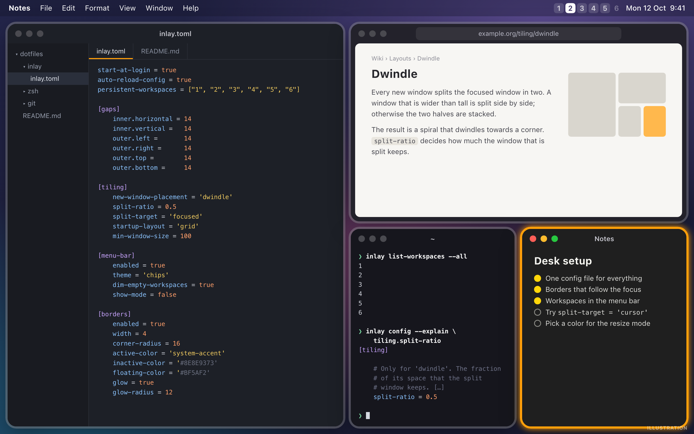</p>

<sub>About the images of this page: the ones marked **Real render** are drawn by Inlay itself, off screen, with the
same code that draws the menu bar item, the borders and the Settings window (see [Development](#development)); the
ones marked **Real output** are text printed by the scripts and the CLI; and the ones marked **Illustration**,
like the one above and all the animations, are drawings that follow the rules of the layout, not screenshots.</sub>

## Project status

**Version 0.1.0, in its first round of real use.** Inlay is a fork of
[AeroSpace](https://github.com/nikitabobko/AeroSpace) that builds without Xcode, with its own way of placing
new windows (*dwindle*), without the *accordion* layout, with its own menu bar item and with window borders.

| Part | Status | How it is verified |
|---|---|---|
| Build, install and uninstall without Xcode | Done | Clean build from scratch with the Command Line Tools; `install.sh` and `inlay uninstall` run end to end in an isolated environment (another `HOME`, another install folder) |
| Window manager (tree, workspaces, commands, CLI) | The one of AeroSpace `74a1bf1`, under another name | Tests (simulated windows) |
| *Dwindle*-style auto-tiling, no *accordion* layout | Done (see [Tiling](#tiling)) | Tests (simulated windows), including a pseudorandom session of 800 steps |
| Menu bar item with *chips*, themes and Settings window | Done (see [Menu bar and settings](#menu-bar-and-settings)) | Tests and rendered images |
| Window borders | Done, with public API (see [Window borders](#window-borders)) | Tests, rendered images and `--debug-borders` on real windows |
| Tests | 651 Swift Testing tests (`scripts/test.sh`): the whole original AeroSpace suite migrated, plus the ones of Inlay | They pass with the Command Line Tools |

The "How it is verified" column says what has been verified automatically. In addition, Inlay has already been
installed and used with the Accessibility permission in two rounds (2026-10-11). In the second one, with the
version that already had the stable signature, the grid at startup, the place recovery, the *glow*, the
informational-only item and the colors per mode, no problem was noticed with the borders (no lag, no wrong
order, no orphan borders). The changes of this revision came out of that second round, and they **have not
yet been tried in real use**, only with tests: `split-target` and `min-window-size`, dialogs without a border,
6 workspaces in the shipped config, the menu bar item without a highlight on left click, the key bindings of
the menu as text, and the minimized window that goes back to its workspace. The same goes for the third
revision (installing without options, `inlay.toml` as the shipped config, the question about the symbolic link,
`inlay uninstall`, `inlay config --explain` and the reload of a config saved by hand): tried in an isolated
environment and with tests, not yet in real use. And for the latest one: the binding mode in the marker of
the focused workspace, the menu without icons, the Settings window that fits small screens, the config folder
linked by `install.sh` and `inlay uninstall` removing the config.

Known limitations of this version:

- The borders are placed with a public API that does not tie them to their window: between the moment a window
  changes and the next refresh, its border may be briefly out of place or below another window.
- Apple Silicon only (the binary is `arm64`) and a single display tested.
- The interface (menu, Settings, messages) is in English.

The config format and the commands are the ones of AeroSpace with the differences described in
[Tiling](#tiling): its [guide](https://nikitabobko.github.io/AeroSpace/guide) and its
[list of commands](https://nikitabobko.github.io/AeroSpace/commands) apply, replacing `aerospace` with `inlay`.
There is a copy of that documentation in [`docs/upstream-aerospace`](./docs/upstream-aerospace).

## Requirements

- macOS 14 or later (tested on macOS 27, Apple Silicon).
- Xcode Command Line Tools with Swift 6.2 or later: `xcode-select --install`.
- Internet connection the first time it is built (SwiftPM downloads four dependencies from GitHub).

## Installation

```sh
git clone <this repo> inlay && cd inlay
./install.sh
```

No option is needed. `install.sh`:

1. builds `Inlay.app` and signs it with a local identity, so that macOS keeps the Accessibility permission
   across rebuilds (see [Signing](#signing));
2. installs it in `/Applications` (or in `~/Applications` if there are no permissions) and links the `inlay`
   CLI in `~/.local/bin`, `/opt/homebrew/bin` or `/usr/local/bin`;
3. creates `~/.config/inlay/inlay.toml` as a copy of the [`inlay.toml`](./inlay.toml) of the repo, **if you
   have no Inlay config yet**. A config that already exists is yours: see
   [A config that you already have](#a-config-that-you-already-have);
4. **asks, every time, whether you want to use a config folder of your own through a symbolic link** (one
   you keep in a dotfiles repo, for example). Enter means no and keeps what you have. See
   [Your own config folder](#your-own-config-folder). Without a terminal to ask on (stdin is not a TTY) it
   asks nothing;
5. checks the config with the parser of the app it has just installed and prints its errors and warnings
   (they never stop the installation);
6. **opens Inlay** and says so, with what to do the first time (see
   [Before opening Inlay](#before-opening-inlay)).

<p align="center">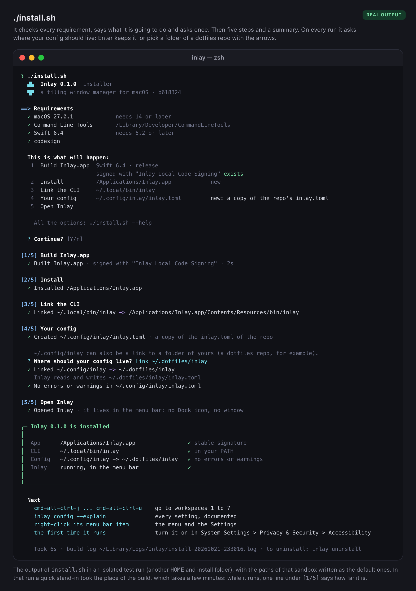</p>

It can be run as many times as needed: it updates what is installed, quitting the running copy first.

| Option | Effect |
|---|---|
| `--reset-config` | Replaces your config by the `inlay.toml` of the repo, whatever is in it, and keeps yours next to it as `inlay.toml.backup-<date>`. See [A config that you already have](#a-config-that-you-already-have) |
| `--config-link FOLDER` | Links `~/.config/inlay` to `FOLDER` instead of asking, with the rules of [Your own config folder](#your-own-config-folder). Also on a reinstall |
| `--no-prompt` | Asks nothing and keeps the config as it is |
| `--import-aerospace` | If you have no Inlay config, start from your `~/.aerospace.toml` instead of `inlay.toml` |
| `--no-open` | Does not open Inlay when done |
| `--adhoc-signing` | Ad hoc signature instead of the local identity (see [Signing](#signing)) |
| `INSTALL_DIR=…` | Folder where the app is installed |
| `INLAY_BIN_DIR=…` | Folder where the CLI is linked |

With `--import-aerospace` your `aerospace.toml` is copied as is (if it is a symbolic link, the file it points to
is copied and the original is not touched). Check three things in the copy: `start-at-login = true` would make
Inlay add itself to the login items the first time it starts; the key bindings or scripts that call the
`aerospace` CLI keep talking to AeroSpace and must call `inlay`; and with `gaps` of 8 or less the borders of
two neighboring windows touch.

### Your own config folder

On every run, also when you already have a config, `install.sh` asks:

```
Use a config folder of your own through a symbolic link? [y/N]
```

Enter (or `n`) keeps what you have. With `y` it asks for the path of a **folder** (`~` is expanded;
`~/.dotfiles/inlay`, for example) and makes **`~/.config/inlay` a symbolic link to that folder**. Inlay reads
and writes the `inlay.toml` in it; nothing else in the folder is touched.

| What it finds | What it does |
|---|---|
| The folder does not exist | Warns and links nothing. Your config stays as it is: on a new install, the copy of `inlay.toml` in `~/.config/inlay/` |
| The folder has no `inlay.toml` | Warns and asks `Copy the inlay.toml of the repo into <folder>? [y/N]`. With no, nothing is copied and nothing is linked |
| You had a real `~/.config/inlay` | It is not deleted: it is renamed to `~/.config/inlay.backup-<date>`, and the script says so |
| `~/.config/inlay` is already a link | The question says it (`currently linked to …`), and Enter changes nothing. Linking another folder replaces only the link: the folder it pointed to is not touched |
| Only the file is linked (`~/.config/inlay/inlay.toml -> your file`, the way a previous version did it) | It keeps working and Enter leaves it alone. With `y`, the folder that holds your file is offered as the path, and the old `~/.config/inlay` becomes the backup |
| Your config is `~/.inlay.toml` | The question is skipped: Inlay reads one file or the other, never both |

`--config-link FOLDER` does the same without asking (a folder without `inlay.toml` is only filled in when
there is a terminal to ask on), and `--no-prompt` skips the question. To stop using your folder, remove the
link (`rm ~/.config/inlay`) and run `./install.sh` again.

### A config that you already have

`install.sh` never edits or deletes a config, and it replaces one only in two cases, always keeping the old
one next to the new one as `inlay.toml.backup-<date>` (`inlay.toml.backup-20261012-153000`):

- **It is a default config of a previous version of Inlay, exactly as it was installed.** The script
  compares it, byte for byte (SHA-256), with every default config that Inlay has shipped
  ([`scripts/default-config-hashes.txt`](./scripts/default-config-hashes.txt)). If it is one of them, nobody
  has edited it, so it is replaced by the current `inlay.toml` and the script says so. This is what updates a
  Mac that was installed when the default config was still the one of AeroSpace: `alt-…` key bindings and
  no rule that sends a window to a workspace, so every window stayed in the workspace on the screen.
- **You pass `--reset-config`.** Whatever the config is, it is replaced by the `inlay.toml` of the repo.

Any other config is **kept as it is**, and the script warns about it: what is new in the `inlay.toml` of the
repo (key bindings, rules, options) is not in it. It also tells if the config has no `on-window-detected`
rule, and prints the two commands that matter: `./install.sh --reset-config` to switch to the config of the
repo, and a `diff` to compare them. A config changed from the Settings window counts as edited: it is kept.

A config that is reached through a **symbolic link** (a linked folder, or a linked file) is always taken for
your own, whatever is in it: it is never replaced on its own. `--reset-config` never writes, moves or deletes
what a link points to either:

- with a **linked folder**, the link itself is renamed to `~/.config/inlay.backup-<date>` (it still points to
  your folder) and `~/.config/inlay` becomes a real folder with the `inlay.toml` of the repo. The script prints
  the command that links your folder again;
- with a **linked file**, the link is renamed to `inlay.toml.backup-<date>`, still pointing to your file.

To go back to a backup: `mv ~/.config/inlay/inlay.toml.backup-<date> ~/.config/inlay/inlay.toml`.
After changing `inlay.toml` in the repo, `scripts/update-default-config-hashes.sh` adds it to the list (a test
fails until it is there).

### Before opening Inlay

- **Quit AeroSpace, AeroMenu and `borders` (JankyBorders).** They do the same job, and two window managers at
  once fight over the windows. `install.sh` never quits another app: if it detects any of them running, it
  installs everything, explains why it did **not** open Inlay and prints the command to open it once you have
  quit them. Inlay can be *installed* alongside AeroSpace without any problem: they share no config, socket,
  preferences or identifier.
- **Accessibility permission.** Inlay moves the windows with the Accessibility API. The first time, macOS asks
  for the permission: enable it in *System Settings › Privacy & Security › Accessibility* (you need to be an
  administrator; on a managed machine that list may be locked). As long as it does not have it, Inlay does
  nothing: its menu bar item shows a warning triangle and the CLI answers "Can't connect to Inlay server".
  Once it has it, Inlay sends the windows that are already open to the workspaces of their rules and arranges
  them (see [Tiling](#tiling)).
  If Inlay appears enabled in the list but keeps asking for it (it happens after rebuilding with an ad hoc
  signature), remove it from the list with the "−" button and open Inlay again.

### Signing

macOS ties the Accessibility permission to the signature of the app. That is why `install.sh` signs **by
default with a stable identity**: it creates, only once, a self-signed identity ("Inlay Local Code Signing") in
your login keychain and signs with it, so the permission is kept across builds. macOS may ask for the keychain
password the first time `codesign` uses the key: choose "Always Allow". If the identity cannot be created or
used, the app is signed ad hoc and a warning is shown.

On a Mac where the identity does not exist yet (a fresh clone on another machine) the same `./install.sh`
creates it: nothing has to be passed.

With `--adhoc-signing` the identity is not used: the ad hoc signature is enough to run Inlay on this Mac, but
the permission is lost **every time it is rebuilt** and has to be granted again. (`--stable-signing` is still
accepted: it is now what is done by default.)

`scripts/build-app.sh` signs with that identity if it already exists (it never creates it) and ad hoc if not;
`scripts/build-app.sh --sign-identity -` forces the ad hoc signature.

### Configuration

Inlay reads `~/.config/inlay/inlay.toml` (or `$XDG_CONFIG_HOME/inlay/inlay.toml`) or else `~/.inlay.toml`; if
both exist, it warns about the ambiguity and loads neither. The app, the CLI and the Settings window all use
that same file. (`XDG_CONFIG_HOME` only counts if it is set for the apps that macOS starts, not just in your
shell: `install.sh` warns when it sees it set.)

**The shipped config is [`inlay.toml`](./inlay.toml), at the root of the repo.** It is the file that
`install.sh` copies, and a copy of it travels inside the app as the fallback for when there is no config at
all. It is a real config rather than a neutral sample: 6 persistent workspaces, key bindings on
`cmd-alt-ctrl-…` and `cmd-alt-shift-…`, the `service` and `resize` modes and `on-window-detected` rules that
send each app to its workspace. Make it yours by editing your copy, or keep your config in a folder of your
own and link it (the question of `install.sh`, or `--config-link`).

The rules are checked from top to bottom, and **the first one that matches a window is the only one that runs
for it** (a rule with `check-further-callbacks = true` lets the next ones run too; the shipped config has
none). In `inlay.toml` they come in this order:

1. the panels to open or save a file float where they open;
2. the apps with a workspace go to it: terminals to 1, editors to 2, browsers to 3, chats to 4, AI to 5;
3. the quick apps (Finder, System Settings, Calculator…) and the settings window of any app float where they
   open;
4. **every other tiling window goes to workspace 6**, the one of the secondary display when there are two.

The last rule is a catch-all one:

```toml
[[on-window-detected]]
if = 'test %{window-layout} ~= _tiles'   # h_tiles or v_tiles: a tiling window
run = 'move-node-to-workspace 6'
```

It only matches the windows that Inlay tiles. What Inlay takes for a dialog (a sheet, an alert, an "About"
window) is already floating when the rules run, so it does not match and stays where it opens; popups never
get to the rules. As with the apps that have a workspace, the window goes to 6 and the focus stays where it
was: with a single display the window of an app without a rule leaves the screen as it opens, and
`cmd-alt-ctrl-p` goes to it. To keep an app out of workspace 6, give it a rule above (a workspace of its own,
or `layout floating`); to have every other window stay in the workspace where it opens, as AeroSpace does,
delete the rule. Like every rule it runs once per window: a window that you move out of workspace 6 stays where
you put it, until you run the rules again by hand (`w` in the `service` mode).

**Every key is documented in [`docs/config-reference.toml`](./docs/config-reference.toml)**: what it does,
its possible values and its default, for the keys inherited from AeroSpace and for the ones of Inlay. The
`inlay` CLI prints it, without needing Inlay to be running:

```sh
inlay config --explain                 # the whole reference
inlay config --explain borders.width   # one key
inlay config --explain tiling          # one table ([menu-bar] also prints [menu-bar.colors])
inlay config --explain gaps.inner      # a group of keys
```

<p align="center">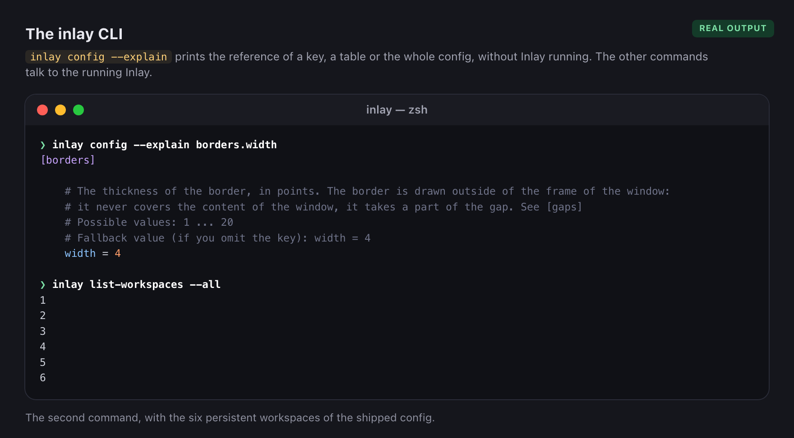</p>

A test fails if the config parser accepts a key that the reference does not document, or the other way round.

**The file and the Settings window stay in sync in both directions.** Settings writes its changes to the file
(see [Menu bar and settings](#menu-bar-and-settings)). In the other direction, with
`auto-reload-config = true` (it is set in the shipped `inlay.toml`; the default of the key is `false`), Inlay
reloads the config when the file is saved by hand, and the Settings window, if it is open, the menu bar item
and the borders show the new values right away, without closing anything. It works when `~/.config/inlay` is
a symbolic link to a folder of yours, when the file itself is a link, with editors that save by writing a new
file and renaming it over the old one, and when a link is pointed somewhere else. A save that leaves the file unreadable as TOML
is not applied (the previous config stays, and a window shows the error); the next save is picked up as usual.
Without that key, reload by hand: `inlay reload-config` or *Reload Config* in the menu, which refresh
Settings the same way. Settings writing the file does not cause a second reload.

```toml
auto-reload-config = true   # the default is false: reload with 'inlay reload-config' or from the menu
```


**Problems are never silent.** If the config has errors or warnings, `inlay reload-config` prints them, a
window lists the errors, and the menu of the menu bar item shows "Config contains errors…" or "Config contains
warnings…". A key binding that macOS refuses to register (another app may own the same keys) is reported the
same way, as a warning that names the binding. While *Secure Input* is active (a password field is focused),
macOS delivers no key bindings to anybody: Inlay shows a shield in the corner of the screen. To check a file
without loading it:

```sh
/Applications/Inlay.app/Contents/MacOS/Inlay --check-config ~/.config/inlay/inlay.toml
```

The programs that Inlay launches receive the variables `INLAY_WINDOW_ID`, `INLAY_WORKSPACE`,
`INLAY_FOCUSED_WORKSPACE` and `INLAY_PREV_WORKSPACE` (and also under the `AEROSPACE_*` name, so that scripts
written for AeroSpace keep working).

### Gaps

The `[gaps]` table sets, in points, the gaps between windows (`inner.*`) and between the windows and the edges of
the monitor (`outer.*`). A key that is omitted is 0. A value can also depend on the monitor
(`outer.top = [{ monitor.main = 16 }, 24]`: see `inlay config --explain gaps`).

```toml
[gaps]
    inner.horizontal = 8   # between two windows that are side by side
    inner.vertical =   8   # between two windows that are one above the other
    outer.left =       8
    outer.bottom =     8
    outer.top =        8   # under the menu bar
    outer.right =      8
```


The window borders are drawn in the gaps: see [Window borders](#window-borders) for how the two fit together.

### Tiling

A new window **splits the focused window in two**, like the *dwindle* layout of Hyprland: if the focused one is
wider than it is tall they end up side by side; otherwise, stacked. The new one goes to the right or below.
When a window is closed, its neighbor gets the space back.


```toml
[tiling]
    new-window-placement = 'dwindle'   # or 'after-focused': the behavior of AeroSpace
    split-ratio = 0.5                  # 0.1 – 0.9: fraction kept by the window that is split
    split-target = 'focused'           # or 'cursor': the new one splits the window under the cursor
    startup-layout = 'grid'            # 'grid' | 'row' | 'dwindle': the windows that were already open
    min-window-size = 100              # 20 – 500 pt: how far `resize` and the mouse can shrink
```

**How much each one gets** (`split-ratio`, only with `dwindle`): the fraction of its space that the window that
is split keeps, from 0.1 to 0.9. With 0.5, two halves; with 0.6, it keeps 60% and the new window gets 40%.

```toml
[tiling]
    split-ratio = 0.5
```

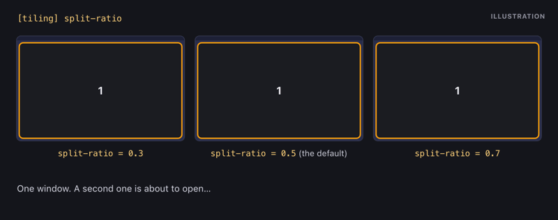

**Which window is split** (`split-target`, only with `dwindle`): with `'focused'` (the default), the focused
one; if the focused one is not tiled in that workspace, the most recent tiled one. With `'cursor'`, the tiled
window under the mouse cursor, as in Hyprland; if there is none (the cursor is in a gap, on another monitor or
over a fullscreen window, or the target workspace is not visible), `'focused'` applies. Floating windows do
not count: under a floating one, the tiled window behind it is considered.

```toml
[tiling]
    split-target = 'focused'   # or 'cursor'
```


**Minimum size** (`min-window-size`, 100 pt by default): the `resize` command and dragging an edge with the
mouse stop shrinking a window when it reaches that width or height, and they do not shrink the neighbors below
it either when the other one is the one growing (the neighbors that still have room give up the rest). With
the mouse, the edge that was dragged beyond it goes back to the limit on release. Reaching the limit is not an
error: `resize` exits with code 0 and no message, the same as before (it has no `--fail-if-noop`), because in
a resize mode with the key held down the limit is reached continuously. It only limits resizing: if the
windows of a workspace do not fit with that size (many windows on a small monitor, or a window split several
times), the distribution gives them less, down to the safety floor of the layout (the inner gap plus 1 pt),
and `resize` simply does not shrink them any further. `resize` always works in screen points.

```toml
[tiling]
    min-window-size = 100   # 20 ... 500 points
```


Both keys are also in **Settings › General › Tiling** ("Window to split" and "Minimum window size").

The windows that **are already open when Inlay starts** (or when it is resumed with `inlay enable on`) are not
placed one by one. First the `on-window-detected` rules of the config run for each of them, exactly as for a
new window, so every window goes to the workspace of its rule (or becomes floating, or whatever the rule
says). Then the windows are distributed, workspace by workspace, according to `startup-layout`. With the
shipped config, the terminals end up in workspace 1, the editors in 2, the browsers in 3, and so on, the
windows of the apps without a workspace in 6, each workspace with its own grid. The workspaces are arranged
once the rules of every window are over, also when macOS reports another event in the middle of the startup. The rules run once per window: later refreshes do not evaluate them again, so a
window that you move somewhere else stays there. On resume, they only run for the windows that appeared
while Inlay was paused. To run them again for all the open windows, use
`inlay run-callback on-window-detected --for-every-window` (`w` in the `service` mode of the shipped config).

| `startup-layout` | Result |
|---|---|
| `'grid'` (the default) | Balanced grid: `ceil(√n)` columns and as many rows as needed, all rows with the same height. The last row shares its width among the windows it has: 5 windows are 3 on top and 2 below; 3 are 2 on top and 1 below |
| `'row'` | A single row with all the windows at the same width |
| `'dwindle'` | No distribution: each window enters as a new window, one after another (with `new-window-placement = 'dwindle'`, a spiral with the last ones very small) |

```toml
[tiling]
    startup-layout = 'grid'   # 'grid' | 'row' | 'dwindle'
```


It only affects that moment. The windows you open afterwards follow `new-window-placement`, and the grid is a
normal tree: it can be moved, resized and rearranged with the usual commands. When resuming after a pause,
only the workspaces in which some window appeared while Inlay was paused are rearranged; the others keep
their arrangement. It is also in **Settings › General › Tiling**.

A window that leaves the tiling because macOS **minimizes** it, puts it in **native fullscreen** or **hides
its app** remembers its place (container, position, size and the neighbor that kept its space) and gets it
back when it returns:

- If its container still exists, it goes back to its position and the neighbor gives the space back.
- If the container is gone (it had only two windows and was flattened), the neighbor is split again the same way as before.
- If neither the container nor the neighbor is left, it enters as a new window.


A **minimized** window also remembers its workspace (a minimized window does not belong to any). If it is
restored while you are in another workspace, it goes back to its own and to its place, and **the focus follows
it**: Inlay switches to that workspace. If the place is no longer recoverable, it enters its workspace as a new
window. Only if its workspace no longer exists (it was not persistent and was left without windows) does it
enter as a new window in the focused workspace.

Inlay **has no *accordion* layout**. To be able to use an `aerospace.toml` as is, its forms are accepted with
a warning (not with an error) and are treated as `tiles`:

| In the `aerospace.toml` | In Inlay |
|---|---|
| `default-root-container-layout = 'accordion'` | `'tiles'` is used |
| `accordion-padding = 30` | Ignored |
| `layout accordion`, `layout h_accordion`, `layout v_accordion` | `layout tiles`, `layout h_tiles`, `layout v_tiles` |
| `layout tiles accordion` (toggle) | `layout tiles` |

The warnings show up in `inlay reload-config` and in the menu of the menu bar item ("Config contains warnings...").

## Menu bar and settings

The menu bar item shows **all the workspaces** and marks the focused one (it does not distinguish monitors). It
is configured in the `[menu-bar]` table of the config; `inlay config --explain menu-bar` documents it.

<p align="center">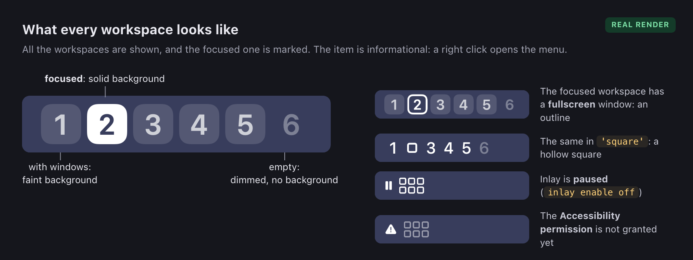</p>

| Key | Values | Default |
|---|---|---|
| `enabled` | `true`, `false` | `true` |
| `theme` | `'chips'`, `'square'`, `'minimal'` | `'chips'` |
| `dim-empty-workspaces` | `true`, `false` | `true` |
| `show-mode` | `true`, `false` | `true` |
| `[menu-bar.colors]` `accent`, `focused`, `occupied`, `empty` | color or `'auto'` | `'auto'` |

**`theme`**: the shape of the item.

```toml
[menu-bar]
    theme = 'chips'   # 'chips' | 'square' | 'minimal'
```

<p align="center">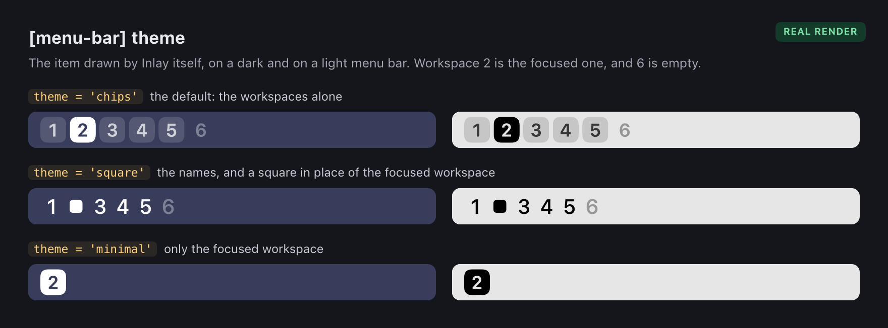</p>

The item shows no app icons. `theme = 'chips-icons'` and the `show-app-icons` key, of a previous version, are
still accepted so that a config that has them loads (the Settings window wrote them): they give a warning,
the theme is treated as `'chips'` and the key is ignored. Picking a theme in Settings removes both.

**`dim-empty-workspaces`, `show-mode`**: what the item shows besides the names. With
`enabled = false` there is no item at all, and Inlay keeps working with the key bindings and the CLI.

```toml
[menu-bar]
    enabled = true
    dim-empty-workspaces = true
    show-mode = true              # the initial of the binding mode on the marker of the focused workspace
```

With `show-mode = true`, while the binding mode is not `main` (`resize`, `service`…), **the marker of the
focused workspace carries the initial of the mode**, the way Aeromenu did it. In `chips` and `minimal` the
initial takes the place of the name in the chip; in `square` the square grows from 8.5 to 14 pt to hold it.
Nothing is added next to the workspaces, so the item is exactly as wide in every mode and nothing in the menu
bar moves. While a window of the workspace is fullscreen, the marker is an outline and the initial is drawn
inside it. The key governs the three themes (`square` used to show the mode always).

<p align="center">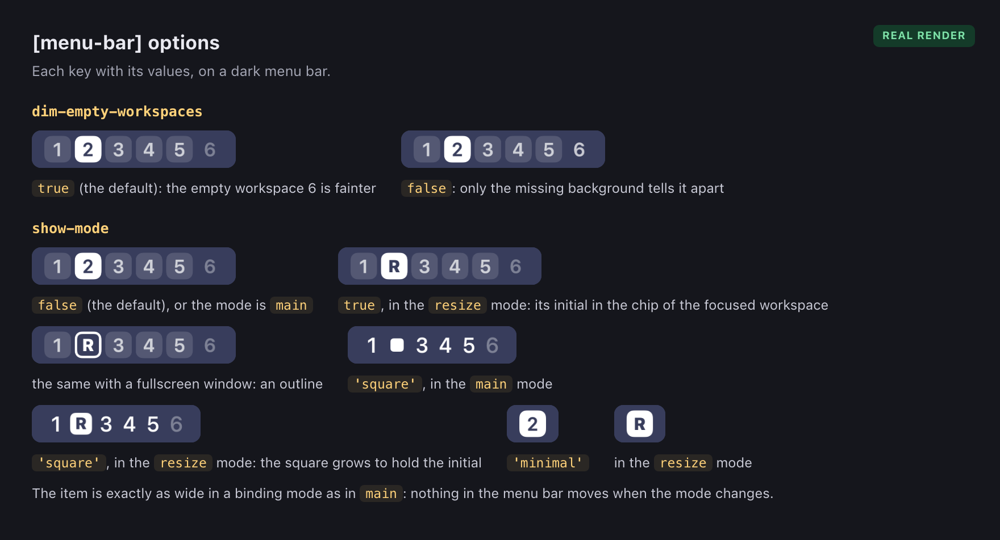</p>

**`[menu-bar.colors]`**: a color is `'#RRGGBB'`, `'#RRGGBBAA'` or `'system-accent'`. `'auto'` is the color of
the menu bar text (white on a dark bar, black on a light one). With everything set to `'auto'`, the
item is a template image identical to the one of Aeromenu, also while it shows a binding mode; a fixed color
does not adapt to the bar. `accent` is the color of the marker while it shows the binding mode: `'auto'` is
the same as `focused`, and over a fixed color the initial is white, or black if the color is light.

```toml
[menu-bar.colors]
    accent = 'auto'            # the marker of the focused workspace while it shows the binding mode
    focused = 'auto'           # the background of the focused workspace
    occupied = 'auto'          # the workspaces with windows: the name and, at 16%, its background
    empty = 'auto'             # the workspaces without windows
```

<p align="center"></p>

**The item and its menu**

<p align="center">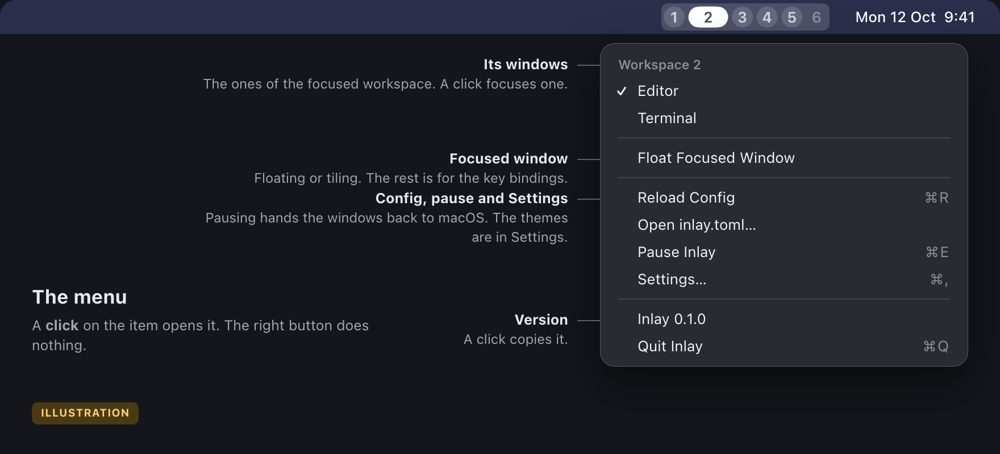</p>


- The item is **informational only**: the left click does nothing (it does not switch workspace or open the
  menu). The **right click** (or ctrl-click) opens the menu: the workspaces, *Float Focused Window*, the
  config, pause and Settings. With VoiceOver, "pressing" the item (VO-space) opens the menu. To switch workspace: the
  key bindings, the CLI or the *Workspaces* section of the menu. The left click does not highlight the item
  either: the button never gets to see the mouse (a transparent view on top of it takes it). With the menu
  open, the item is highlighted like any menu of the menu bar. A ⌘-drag still moves the item along the bar.
- The menu is short on purpose. It lists the workspaces with the names of the apps that have windows in each
  one, as text and without icons (choosing one switches to it), toggles the focused window between floating and tiling, and has what concerns
  Inlay itself: *Reload Config*, *Open inlay.toml…*, *Pause/Resume Inlay*, *Settings…*, the version (a click
  copies it, with the commit) and *Quit*. Moving a window to another workspace, fullscreen, the layout and the
  binding modes are not in it: they are done with the key bindings. **The menu does not show the key bindings
  of your config** next to its items. Its own shortcuts (⌘R, ⌘E, ⌘, and ⌘Q) only exist while it is open.
  When the last load of the config had errors or warnings, an item at the top says so and shows them.
- The shipped config defines **6 persistent workspaces** (1–6), which are the ones the item always shows. Any
  other workspace exists (and appears in the item) while it has windows or is the visible one.
- **Settings…** (⌘, in the menu, or opening Inlay again from Applications) edits those keys **in your config
  file**, line by line and without touching comments or the rest of the file, and reloads the config. If the
  config folder or the file is a symbolic link, the file is written where it really lives and the link stays. If you have no config yet, the first change creates
  `~/.config/inlay/inlay.toml` from the shipped one. A key written with dots (`menu-bar.theme = …`) or
  inside an inline table is not edited from Settings: its control appears disabled. A subtable that does not
  exist yet (`[menu-bar.colors]`, `[borders.mode-colors]`) is added right after its parent table.

### The Settings window

Three tabs, **General**, **Menu Bar** and **Borders**. Next to every control is the key it writes. These are the
tabs with the shipped config (click one to see it at full size):

<table>
<tr>
<td valign="top"><a href="docs/images/settings-general.png">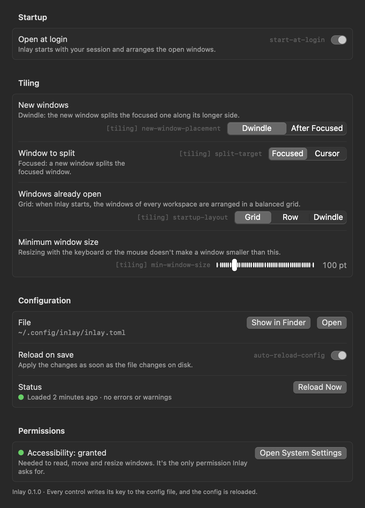</a></td>
<td valign="top"><a href="docs/images/settings-menu-bar.png">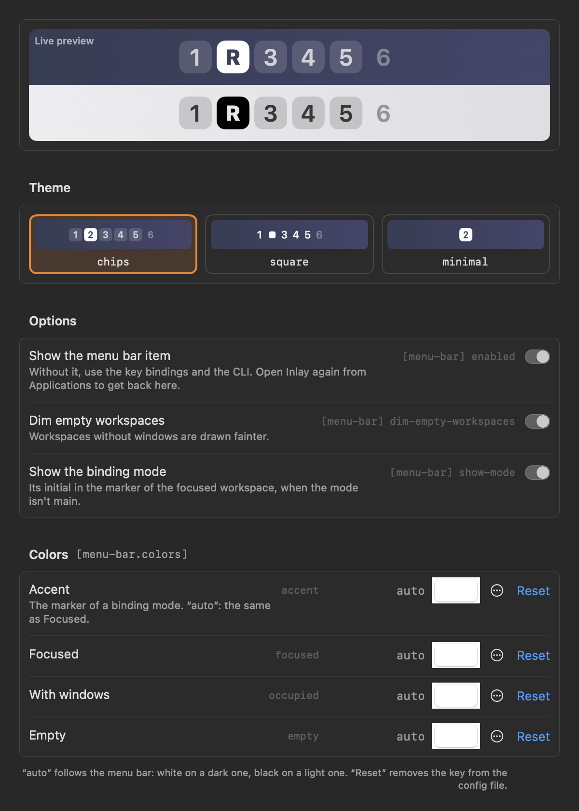</a></td>
<td valign="top"><a href="docs/images/settings-borders.png">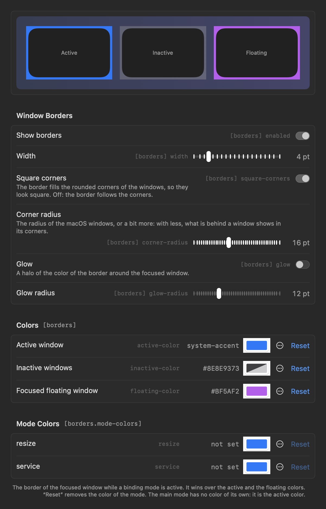</a></td>
</tr>
<tr><td align="center"><sub>General</sub></td><td align="center"><sub>Menu Bar</sub></td><td align="center"><sub>Borders</sub></td></tr>
</table>

<sub>Real renders, drawn off screen by `Inlay --render-settings` (see [Development](#development)): only the content
of each tab, without the title bar and the tab bar of the window.</sub>

The window is never taller than the usable part of the screen and never leaves it. A tab that does not fit
(on the screen of a small laptop, General is taller than what the menu bar and the Dock leave) scrolls, so
every control can be reached. `Inlay --debug-settings <config> [--inspect] [--screen-height <points>]` opens
the window alone, without the window manager, against a config file of your choice.

How the window and the file follow each other is in [Configuration](#configuration).

## Window borders

Inlay draws a colored border around each managed window (tiled or floating) of the visible workspaces. The
color comes from the state the manager already knows, with no focus heuristics. It is configured in the
`[borders]` table (`inlay config --explain borders` documents it), or in the **Borders** tab of Settings.

<p align="center"></p>

| Key | Values | Default |
|---|---|---|
| `enabled` | `true`, `false` | `true` |
| `width` | 1 … 20 (points) | `4` |
| `corner-radius` | 0 … 40 (points) | `16` |
| `active-color` | color | `'system-accent'` |
| `inactive-color` | color | `'#8E8E9373'` |
| `floating-color` | color | `'#BF5AF2'` |
| `glow` | `true`, `false` | `false` |
| `glow-radius` | 1 … 40 (points) | `12` |
| `[borders.mode-colors]` `<mode>` | color | empty table |

**The colors.** The image above shows them all.

```toml
[borders]
    enabled = true
    active-color = 'system-accent'   # the focused window, if it is tiled
    inactive-color = '#8E8E9373'     # the windows that are not focused. '#00000000': no border
    floating-color = '#BF5AF2'       # the focused window, if it is floating

    [borders.mode-colors]            # the focused window while a binding mode is active
        resize = '#30D158'
```

**`width`**: the thickness, outside of the window.

```toml
[borders]
    width = 4   # 1 ... 20 points
```

<p align="center">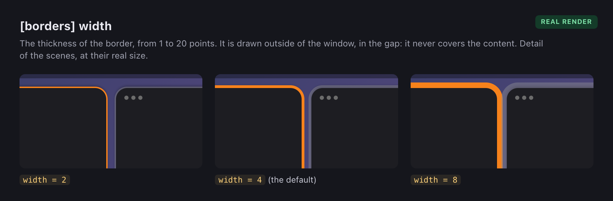</p>

**`corner-radius`**: tuned by eye, because macOS does not let Inlay read the radius of the windows of other apps.

```toml
[borders]
    corner-radius = 16   # 0 ... 40 points. 0 = square corners
```

<p align="center">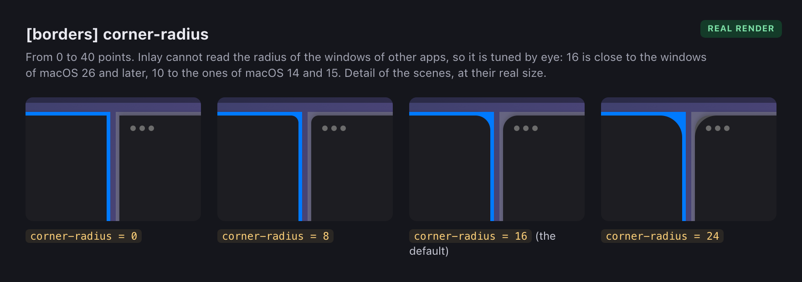</p>

**`glow` and `glow-radius`**: a halo around the focused window.

```toml
[borders]
    glow = true
    glow-radius = 12   # 1 ... 40 points
```

<p align="center">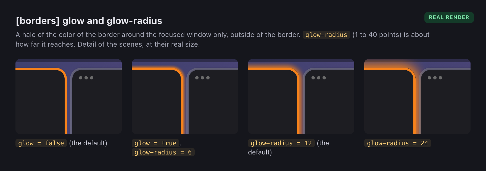</p>

**Borders and gaps**: the border takes a part of the [gap](#gaps).

```toml
[gaps]
    inner.horizontal = 8   # at least twice borders.width leaves air between two borders
[borders]
    width = 2
```

<p align="center">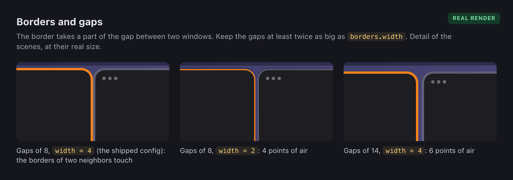</p>

The details:

- **Color of the focused window**: the one of the active binding mode if it has an entry in
  `[borders.mode-colors]`; otherwise, `floating-color` if it is floating; otherwise, `active-color`. The other
  windows use `inactive-color`.
- A **fully transparent** color (`'#00000000'`) means "no border": with
  `inactive-color = '#00000000'` only the active window has a border.
- A **fullscreen** window (the `fullscreen` command) keeps its border. Where the outer gaps leave no room for
  it, as with `fullscreen --no-outer-gaps`, it is drawn just inside of the screen.
- **No border**: windows in the native fullscreen of macOS, the tiled windows that a fullscreen window covers,
  minimized windows, windows of hidden apps, popups, the ones of non-visible workspaces, and the window you are
  dragging or resizing with the mouse (the border comes back on release).
- **Dialogs and sheets, no border**: only normal windows, tiled or floating, have a border. What Inlay
  detects as a dialog (the same AeroSpace heuristics that decide which window becomes floating on its own:
  open and save panels, sheets, windows without a fullscreen button…) has no border. A normal window that you
  make floating (`layout floating`, or an `on-window-detected` rule) does have one. If you turn a dialog into
  a tiled window it has a border while it is tiled. With a dialog focused, no window has the color of the
  active one.
- The border goes **outside** the window frame, in the gap between windows: it does not cover content and does
  not receive clicks. The `gaps` should be at least twice the `width`; with smaller gaps the borders of two
  neighboring windows touch or overlap. The shipped config has gaps of 8 and the default border of 4, so
  neighboring borders touch: lower `width` to 2 or 3, or raise the gaps, to leave air between them.
- **Glow** (`glow = true`): a glow in the color of the border around the **focused** window (with whatever
  color applies to it: active, floating or mode), which fades outwards over about `glow-radius` points.
  Unfocused windows never have it. It is exterior: it is not drawn under the border or over the window, but it
  is drawn over whatever is around it (the gap and, if it is wider than the gap, the edge of the neighboring
  windows). It does not receive clicks. It is a small image that Core Animation stretches, so moving or resizing
  redraws nothing.
- The corner radius is fixed: macOS does not let you read the one of other apps' windows. Adjust it by eye.
- The borders disappear when Inlay is paused (`inlay enable off`), on quit and with `enabled = false`.
- **Colors per mode in Settings**: the **Borders** tab has a row for each binding mode defined in your
  config (`[mode.<name>.binding]`), with a color picker and "Reset", which deletes the key from
  `[borders.mode-colors]`. If the table does not exist it is created right after `[borders]`. The `main` mode
  has no row: it is the mode that is always active, and a color of its own would replace `active-color` and
  `floating-color` for good, which exist for that purpose (you can still write `main = '…'` by hand).

Each border is a window of Inlay's own, transparent, placed right above its window in the stacking order, so
a floating window of another app covers the borders of the windows behind it. All with public AppKit API;
there is no JankyBorders code and SkyLight is not used.

## Troubleshooting

Inlay only works when something happens (a window appears, the focus changes, a key binding runs): at rest it
uses about 0 % of the CPU. If it keeps using CPU with nothing going on, two commands tell what it is busy with:

```sh
inlay debug-stats --watch 5               # counters of what Inlay does, printed every 5 s (ctrl-c to stop)
sample Inlay 5 -file ~/inlay-sample.txt   # where the CPU time goes (it comes with macOS)
```

`inlay debug-stats` prints, for every counter, the total since Inlay started and what was counted since the
previous call (`new`, and `per-sec`). It only reads counters that Inlay keeps in memory, and the server answers
it without refreshing anything, so asking does not change the numbers. Leave the Mac alone while it runs: at
rest every `per-sec` should be 0. The one that is not tells what is going on:

| Counter | What it counts |
|---|---|
| `session.complete.*`, `session.light.*` | Refresh sessions: Inlay asks every app for its windows and lays them out |
| `session.trigger.*` | What started each session: `ax.AXMoved` (a window moved), `workspace.NSWorkspaceDidActivateApplicationNotification`, `hotkey`, `cli.<command>`... |
| `ui.publish` | Times the menu bar, the borders and Settings were told that something may have changed |
| `menu-bar.snapshot.changed` / `.same` | Whether that changed what the menu bar item shows |
| `menu-bar.draw.request.*` | Who asked to draw the item: `appearance` (the menu bar behind it), `system-colors`, `screens` |
| `menu-bar.draw.drawn` / `.skipped-same` | Images really drawn, and requests that needed none |
| `borders.op.*`, `borders.restack.*`, `borders.settle` | Borders created, moved, recolored, removed and reordered, and the checks that follow a refresh |
| `config.watcher.*`, `config.load` | Events of the config file watcher, and loads of the config |

## Uninstallation

```sh
inlay uninstall           # quits Inlay and removes the app, the CLI link, the login item and your config
inlay uninstall --purge   # also the preferences of the app and the config backups of install.sh
```

<p align="center">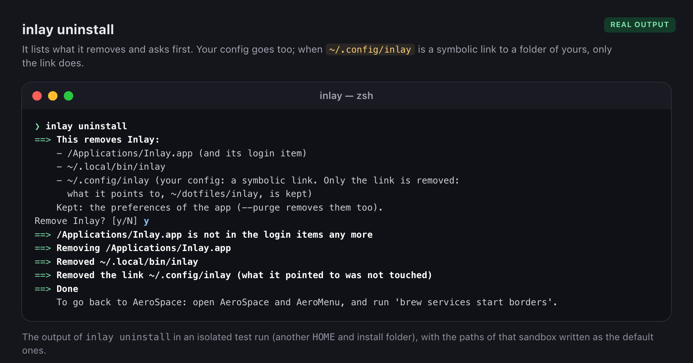</p>

It lists what it is going to remove and asks for confirmation; `--yes` skips the question (and is required
when there is no terminal to answer on). It works whether Inlay is running or not: a running Inlay is quit
first, and on quit it brings the windows of the non-visible workspaces back to the screen. The command
removes the app that contains it, so it runs from a temporary copy of the uninstall script, which deletes
itself at the end.

It removes the app that the `inlay` you ran belongs to, and the copies in `/Applications` and in
`~/Applications`; with `INSTALL_DIR=…` it looks in that folder instead of those two.

**Your config is always removed**: `~/.config/inlay` and `~/.inlay.toml`. The list that you confirm says
exactly what goes:

- `~/.config/inlay` is a real folder: the folder and everything in it are deleted;
- `~/.config/inlay` is a **symbolic link** to a folder of yours: **only the link is removed**. The folder it
  points to and its `inlay.toml` are never touched, and the list names that folder as kept;
- a link inside of a real `~/.config/inlay` (an `inlay.toml` linked by a previous version) goes with the
  folder; the file it points to is never touched.

`--purge` adds what is left behind: the preferences and the runtime files of the app, and the config backups
that `install.sh` made outside of the config folder (`~/.config/inlay.backup-<date>`,
`~/.inlay.toml.backup-<date>`; a backup that is a link is removed as a link). Without `--purge` they are kept,
and the list names them.

`./uninstall.sh` in the repo does the same (it is the same script, with the same options), for when the CLI
is not at hand.

It touches nothing of AeroSpace, AeroMenu or `borders`: to go back to them, open AeroSpace and AeroMenu and run
`brew services start borders`.

The Accessibility entry (`tccutil reset Accessibility com.davidhiguita.inlay`) and the signing identity (delete
it in *Keychain Access* if you want) are not removed.

## Development

```sh
scripts/build-app.sh    # builds and leaves a signed build/Inlay.app (installs nothing)
scripts/test.sh         # runs the tests (accepts the arguments of 'swift test', e.g. --filter DwindleTest)
scripts/make-icon.sh    # regenerates Support/AppIcon.icns from scripts/icon/AppIcon.swift
scripts/make-docs-images.sh   # regenerates the images of this page in docs/images
```

To see the menu bar item without starting Inlay, `--render-menu-bar` draws it off screen (each theme, on a
dark and a light bar, with default and custom colors; `_sheet.png` gathers them all) and exits:

```sh
build/Inlay.app/Contents/MacOS/Inlay --render-menu-bar /tmp/inlay-item
build/Inlay.app/Contents/MacOS/Inlay --render-menu-bar /tmp/inlay-item-6x 6   # enlarged: 6 pixels per point
build/Inlay.app/Contents/MacOS/Inlay --render-settings /tmp/inlay-settings     # the Settings tabs, as PNG
INLAY_RENDER_DIR=/tmp/inlay-item scripts/test.sh --filter SettingsModelTest   # the same tabs, from the tests
```

`--render-settings <dir> [<config>]` draws the tabs as they are with the shipped config, or with the config file
given; it neither reads nor writes your config, and only shows the path a new config would get.

The Settings window can also be opened for real, alone: `--debug-settings <config>` shows it without the
window manager, the menu bar item, the key bindings or the Accessibility permission, editing the config file
you give it (nothing is reloaded), and exits when the window is closed. With `--inspect` it does not wait: it
shows every tab, prints where each control ended up and whether a click reaches it (scrolling to it if it takes
that), and exits with an error if something can't be reached. `--screen-height <points>` makes the window
behave as on a screen that leaves that much height.

```sh
cp inlay.toml /tmp/inlay-test.toml
build/Inlay.app/Contents/MacOS/Inlay --debug-settings /tmp/inlay-test.toml
build/Inlay.app/Contents/MacOS/Inlay --debug-settings /tmp/inlay-test.toml --inspect --screen-height 700
```

The same goes for the borders. `--render-borders` draws them off screen in each state, and `--debug-borders`
shows them for real for a few seconds around the windows that are on screen (without moving anything and
without the Accessibility permission), prints how they ended up stacked and removes them:

```sh
build/Inlay.app/Contents/MacOS/Inlay --render-borders /tmp/inlay-borders
build/Inlay.app/Contents/MacOS/Inlay --debug-borders 5
```

The scripts force `DEVELOPER_DIR=/Library/Developer/CommandLineTools` even if `xcode-select` points to Xcode,
to guarantee that the project does not depend on it. To build by hand:

```sh
DEVELOPER_DIR=/Library/Developer/CommandLineTools swift build
DEVELOPER_DIR=/Library/Developer/CommandLineTools swift test
```

The tests use Swift Testing (XCTest does not come with the Command Line Tools, and no XCTest target is left).
All the suites are nested in `InlayTests` (`extension InlayTests { @Suite @MainActor struct FooTest { ... } }`),
which is `.serialized`: the tests share the global model and cannot run in parallel.

**The images of this page** are made by `scripts/make-docs-images.sh` from the sources in
[`docs/images/src`](./docs/images/src): the real renders come from the three `--render-*` options above; the
sheets that gather them and the illustrations are HTML pages that a headless Google Chrome turns into PNG files;
and the animations are HTML pages too, whose frames `docs/images/src/gif.swift` (built with the Command Line
Tools) assembles into GIF files. Nothing is installed, and Inlay is not started. The renders show the accent
color of the Mac they are made on, and the illustrations use generic windows: no icons and no names of real apps. `scripts/make-docs-images.sh hero gaps`
regenerates only those images, and `--no-build` skips the build of `build/Inlay.app`.

To find out what Inlay would say about any config file without installing or starting anything (errors and
warnings of the real parser):

```sh
build/Inlay.app/Contents/MacOS/Inlay --check-config ~/.aerospace.toml
```

| Path | Contents |
|---|---|
| `Sources/InlayApp` | Entry point of the app (the `InlayApp` product, which in the bundle is `Contents/MacOS/Inlay`) |
| `Sources/AppBundle` | The window manager: tree, commands, configuration, server, interface |
| `Sources/Cli` | The `inlay` CLI (client of the `/tmp/com.davidhiguita.inlay-$USER.sock` socket) |
| `Sources/Common` | Code shared by the app and the CLI |
| `Sources/BuildInfo` | Version and git hash, which `build-app.sh` passes through environment variables |
| `Sources/PrivateApi` | Header of `_AXUIElementGetWindow` |
| `inlay.toml` | The shipped config: what `install.sh` copies and what the app falls back to |
| `docs` | `config-reference.toml` (every config key, printed by `inlay config --explain`), an i3-like example config, a copy of the AeroSpace documentation, and `images` (the images of this page, with their sources in `images/src`) |
| `Tests/InlayTests` | Tests with Swift Testing. `support/` holds the fake windows and other utilities; `fixtures/`, example configs |
| `Support` | `Info.plist` and the bundle icon |
| `scripts` | Build, tests, install, uninstall, icon and the images of the README. `uninstall.sh` and `lib.sh` also travel inside the app, for `inlay uninstall` |
| `axDumps` | Accessibility dumps of real apps used by the tests |

Things to keep in mind:

- **Do not use SwiftUI's `@State`** (or `#Preview`): in the macOS 27 SDK they are macros whose plugin only
  comes with Xcode. Use `@StateObject`/`ObservableObject`, `@Observable` + `@Bindable`, or AppKit.
- The version is in the [`VERSION`](./VERSION) file.

## Attribution and license

Inlay is distributed under the MIT license ([LICENSE](./LICENSE)).

- It derives from **[AeroSpace](https://github.com/nikitabobko/AeroSpace)** by Nikita Bobko (MIT), commit
  `74a1bf1`: the window manager, the config format, the commands and the CLI come from there. Its copyright
  notice is kept. Inlay is not affiliated with the AeroSpace project: please do not report Inlay bugs there.
- The build without Xcode and the install scripts follow the ones of **Aeromenu**, by the same author as Inlay.
- It contains **no** JankyBorders code (GPL-3.0).

The details, with the bundled dependencies and their licenses, are in [NOTICE.md](./NOTICE.md).
