# Inlay

Tiling window manager for macOS, written in Swift. The goal is to bring together in a single native app three
things that today are three programs: the window manager, the borders of the active window and a menu bar item
with the workspaces, all with a single config (`inlay.lua`, which can be split into files).

It builds and installs **with the Xcode Command Line Tools alone**: no Xcode, no Apple account.

<p align="center">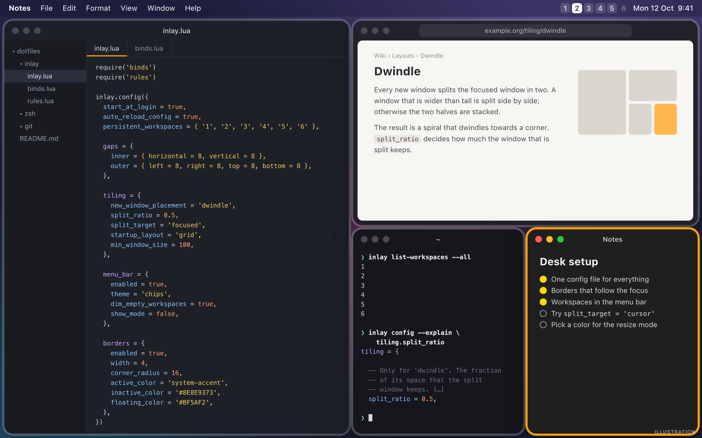</p>

<sub>About the images of this page: the ones marked **Real render** are drawn by Inlay itself, off screen, with the
same code that draws the menu bar item and the borders (see [Development](#development)); the
ones marked **Real output** are text printed by the scripts and the CLI; and the ones marked **Illustration**,
like the one above and all the animations, are drawings that follow the rules of the layout, not screenshots.</sub>

## Project status

**Version 0.6.3, in its first round of real use.** The config is Lua since 0.3.0, made of calls like `inlay.config` and `inlay.bind` since 0.6.0, with snake_case keys since 0.6.2 (see [Configuration](#configuration)), and the look of the borders and of the menu bar comes from a theme since 0.4.0 (see [Themes](#themes)). Your
config goes over the built-in config of Inlay, so it only says what is yours, and `inlay config --show` prints
the config in use (see [Configuration](#configuration)). Inlay is a fork of
[AeroSpace](https://github.com/nikitabobko/AeroSpace) that builds without Xcode, with its own way of placing
new windows (*dwindle*), without the *accordion* layout, with its own menu bar item and with window borders.

| Part | Status | How it is verified |
|---|---|---|
| Build, install and uninstall without Xcode | Done | Clean build from scratch with the Command Line Tools; `install.sh` and `inlay uninstall` run end to end in an isolated environment (another `HOME`, another install folder) |
| Window manager (tree, workspaces, commands, CLI) | The one of AeroSpace `74a1bf1`, under another name | Tests (simulated windows) |
| *Dwindle*-style auto-tiling, no *accordion* layout | Done (see [Tiling](#tiling)) | Tests (simulated windows), including a pseudorandom session of 800 steps |
| Menu bar item with eight themes, configured only in the file | Done (see [Menu bar](#menu_bar)) | Tests and rendered images |
| Themes: the colors of the borders and of the menu bar, from a file | Done (see [Themes](#themes)) | Tests |
| The config of the user over the built-in one, `workspaces`, `config --show`, types for editors | Done (see [Configuration](#configuration)) | Tests |
| Window borders | Done, with public API (see [Window borders](#window-borders)) | Tests, rendered images and `--debug-borders` on real windows |
| Tests | 730 Swift Testing tests (`scripts/test.sh`): the whole original AeroSpace suite migrated, plus the ones of Inlay | They pass with the Command Line Tools |

The "How it is verified" column says what has been verified automatically. In addition, Inlay has already been
installed and used with the Accessibility permission in two rounds (2026-10-11). In the second one, with the
version that already had the stable signature, the grid at startup, the place recovery, the *glow*, the
informational-only item and the colors per mode, no problem was noticed with the borders (no lag, no wrong
order, no orphan borders). The changes of this revision came out of that second round, and they **have not
yet been tried in real use**, only with tests: `split_target` and `min_window_size`, dialogs without a border,
6 workspaces in the shipped config, the menu bar item without a highlight on left click, the key bindings of
the menu as text, and the minimized window that goes back to its workspace. The same goes for the third
revision (installing without options, `inlay.toml` as the shipped config, the question about the symbolic link,
`inlay uninstall`, `inlay config --explain` and the reload of a config saved by hand): tried in an isolated
environment and with tests, not yet in real use. And for the latest one: the binding mode in the marker of
the focused workspace, the menu without icons, the config folder
linked by `install.sh` and `inlay uninstall` removing the config. Also untried in real use: the border and the gap
of a window alone in its workspace or in fullscreen (`borders.single_window`), and the themes taken from
Hyprland setups (`dots`, `underline`, `liquid`, `hypr`): they are checked with tests and renders, including the
frames of their animations. The same goes for the curves of the animations, `per_monitor`, undo, the export of the config, and the latest
revision, which simplified the look: no palettes (every color is set on its own), no notice after a reload
(the menu says when the config was reloaded last), and a menu of native items. Untried in real use too: the menu as a panel with
the layouts of the window and of its workspace. The newest: **there is no Settings window anymore**. Everything
that can be changed without touching the code is in the config file, like the tools of a Linux desktop that are
configured from dotfiles, and `inlay config --use`, `--unlink` and `--export` do from the CLI what the window did
with the file. Untried in real use too: the [themes](#themes), with a theme for each appearance of macOS and
`borders.fullscreen_color`; and the newest, the config of the user over the built-in one, `workspaces`,
`inlay config --show` and `--types`.

Known limitations of this version:

- The borders are placed with a public API that does not tie them to their window: between the moment a window
  changes and the next refresh, its border may be briefly out of place or below another window.
- Apple Silicon only (the binary is `arm64`) and a single display tested.
- The interface (menu, messages) is in English.

The commands are the ones of AeroSpace with the differences described in [Tiling](#tiling): its
[list of commands](https://nikitabobko.github.io/AeroSpace/commands) applies, replacing `aerospace` with
`inlay`. The config is Inlay's own: every key is in [`docs/config-reference.lua`](./docs/config-reference.lua)
(`inlay config --explain`), and `inlay config --show` prints the one in use.
There is a copy of that documentation in [`docs/upstream-aerospace`](./docs/upstream-aerospace).

**The CLI in a terminal.** `inlay` alone says whether Inlay is running, the binding mode, the focused workspace,
where the config is (and whether it has errors), and the commands used most. `inlay --help` groups the commands by
what they are for, with examples first; `inlay --help --all` adds what each one does. In a terminal the
`list-windows`, `list-workspaces`, `list-monitors` and `list-apps` commands print a table (no borders, the focused
one marked with `●`, the columns that don't fit dropped or cut instead of wrapped), `config --show`, `--file` and
`--explain` print the Lua highlighted, and the errors start with `error:` and end with a `hint:`, with the line of
Lua that fails and the command a typo was meant to be. The colors are One Dark when the terminal has truecolor
(`COLORTERM=truecolor`), and the 16 colors of its theme otherwise.

**Piped, nothing changes**: the output of every command is the plain text it always was, so `--format`, scripts
and the bindings read the same. `--json`, `--format` and `--count` always print what they ask for, also in a
terminal. `NO_COLOR` or `TERM=dumb` turn the colors off; `INLAY_COLOR=always|never` forces them on or off.
`inlay --version` prints `inlay <version> <hash>` on its first line, and the version of the running Inlay.app on
the second.

## Requirements

- macOS 14 or later on Apple Silicon (tested on macOS 27).
- To build it from source: Xcode Command Line Tools with Swift 6.2 or later (`xcode-select --install`), and an
  Internet connection the first time it is built (SwiftPM downloads three dependencies from GitHub).

## Installation

### With Homebrew

```sh
brew install --cask de-hv/tap/inlay
```

It installs the app of the latest [release](https://github.com/de-hv/inlay/releases) in `/Applications` and links
the `inlay` CLI in the `bin` folder of Homebrew. Nothing is built, so the Command Line Tools are not needed.

- **The first time, macOS blocks it**: the app is not notarized by Apple. Click *Done* (not *Move to Trash*),
  then *System Settings → Privacy & Security → Open Anyway*. Or remove the quarantine:
  `xattr -dr com.apple.quarantine /Applications/Inlay.app`. Each upgrade brings a new download, blocked again.
- **The config**: without one, Inlay creates a short `~/.config/inlay/inlay.lua` when it starts: your
  config goes over the built-in one, so it only has what is yours (see [Configuration](#configuration)). To use a folder of your own instead: `inlay config --use ~/.dotfiles/inlay` (see
  [Changing the config from the CLI](#changing-the-config-from-the-cli)).
- **Start at login**: open Inlay once (`open -a Inlay`). With `start_at_login = true` in the config (the built-in
  one has it) it adds itself to the login items.
- Then allow it in the Accessibility permission (see [Before opening Inlay](#before-opening-inlay)).

To update it:

```sh
brew update
brew upgrade --cask inlay
```

Homebrew quits Inlay before replacing it; open it again afterwards. Your config is outside of the app: an upgrade
never touches it. **From 0.2 to 0.3**: the config is Lua now, `inlay.lua`. An `inlay.toml` that you never edited
is replaced on its own; one of your own isn't read anymore, and Inlay says so and uses its built-in config until
you write your `inlay.lua` (see [Configuration](#configuration)). **From 0.3 to 0.4**: the colors come from a theme, `material`
without the key `theme`. An `inlay.lua` that you never edited is replaced on its own; in one of your own, the
colors you set in `borders` and `menu_bar` still win over the theme: drop them to use one (see [Themes](#themes)).
**From 0.4 to 0.5**: your config goes over the built-in config of Inlay, which has the rest, so your
`inlay.lua` only needs what is yours (see [Configuration](#configuration)). An `inlay.lua` that you never edited
is replaced by the short one. A full config of yours keeps working: it repeats the values of Inlay (`inlay config
--show --mine` lists them). Three things change: the built-in config sends no app to a workspace (put yours in
`workspaces`), your window rules go before the ones of Inlay, and `configVersion` and the other keys of
AeroSpace are unknown keys: drop them. `inlay config --get`/`--all-keys` are `inlay config --show` now.
**From 0.5 to 0.6**: the config is made of calls, like the Lua config of Hyprland: `inlay.config({ … })`,
`inlay.bind`, `inlay.window_rule`, `inlay.workspace`… instead of a table that `inlay.lua` returns, and
`require('name')` runs a file without `inlay.merge` (see [Configuration](#configuration)). An `inlay.lua` that
you never edited is replaced on its own. One of your own that returns a table gets an error that says how to move
it: the table goes whole in `inlay.config({ … })`, and the key bindings and the rules can stay there or move to
their functions.

### From source

```sh
git clone https://github.com/de-hv/inlay.git && cd inlay
./install.sh
```

No option is needed. First `install.sh` **checks every requirement** (macOS, the Command Line Tools, Swift,
`codesign`) and, if something is missing, lists it all at once with the command that fixes it
(`xcode-select --install`, which it offers to run). In a terminal **every step is a line of a list from the
start, in three groups (Prepare, Install, Configure), marked in place as it goes**: `·` while it waits, a
spinner while it runs, then `✓` (or `!`, `✗`) with a short detail, and each group says how many of its steps
are done. The details are short: the commit, the version of the compiler and the other long values only go to
the log. With 24-bit colors (`COLORTERM=truecolor`) it uses the colors of Material 3, as on Pixel phones;
elsewhere the 16 colors of the terminal, and with `NO_COLOR` or in a pipe, plain text. Before anything is done,
the list says what every step will do (where it installs and links, what happens to your config) and waits
for a key: **Enter installs, Esc cancels** (`--yes` skips the question). What
doesn't fit in the line of a step (a backup that was made, a warning) is said below the list when it is done.
Nothing in the list wraps, also in a narrow terminal, and what you type while it works isn't shown. Then it:

1. builds `Inlay.app` and signs it with a local identity, so that macOS keeps the Accessibility permission
   across rebuilds (see [Signing](#signing)). **Its line says how far the build is**: a bar, `132/214` and
   the time; the whole output goes to
   `~/Library/Logs/Inlay/install-<date>.log` (the last 10 are kept). If the build fails, it prints the end of
   that output, without the progress lines. `--verbose` shows everything as it comes, as does a pipe or a log;
2. installs it in `/Applications` (or in `~/Applications` if there are no permissions);
3. links the `inlay` CLI in `~/.local/bin`, `/opt/homebrew/bin` or `/usr/local/bin`;
4. creates `~/.config/inlay/inlay.lua` as a copy of the [`inlay.lua`](./inlay.lua) of the repo (a short
   config: the rest is the built-in config of the app), **if you have no Inlay config yet**. A config that already exists is yours: see
   [A config that you already have](#a-config-that-you-already-have). Then it **asks, every time, where your
   config should live**: where it is (the first option, what Enter picks) or in a folder of your own through a
   symbolic link (one you keep in a dotfiles repo, for example). See
   [Your own config folder](#your-own-config-folder). Without a terminal to ask on (stdin is not a TTY) it
   asks nothing. It checks the config with the parser of the app it has just installed: its errors and
   warnings go below the list (they never stop the installation);
5. **opens Inlay**.

It ends with one line, `✓ Inlay 0.3.0 is installed  2m 31s · inlay uninstall removes it`, and what to do the
first time: allow Inlay in the Accessibility permission (see [Before opening Inlay](#before-opening-inlay)).

<p align="center">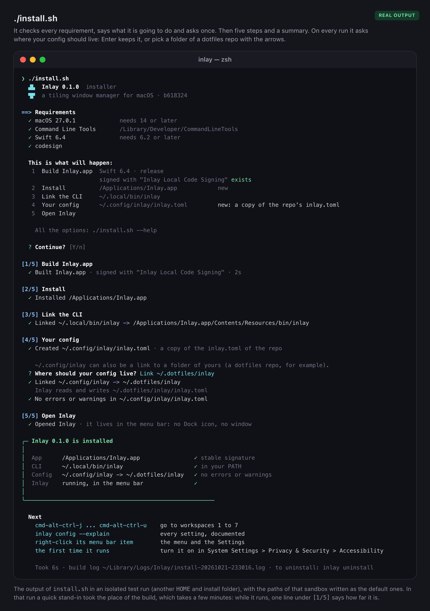</p>

It can be run as many times as needed: it updates what is installed, quitting the running copy first.

| Option | Effect |
|---|---|
| `--reset-config` | Replaces your config by the `inlay.lua` of the repo, whatever is in it, and keeps yours next to it as `<file>.backup-<date>`. See [A config that you already have](#a-config-that-you-already-have) |
| `--config-link FOLDER` | Links `~/.config/inlay` to `FOLDER` instead of asking, with the rules of [Your own config folder](#your-own-config-folder). Also on a reinstall |
| `-y`, `--yes` | Does not ask before starting. The questions about the config are still asked |
| `--no-prompt` | Asks nothing and keeps the config as it is |
| `--no-open` | Does not open Inlay when done |
| `--adhoc-signing` | Ad hoc signature instead of the local identity (see [Signing](#signing)) |
| `--verbose` | Shows the output of the build as it comes, instead of the line that says how far it is |
| `INSTALL_DIR=…` | Folder where the app is installed |
| `INLAY_BIN_DIR=…` | Folder where the CLI is linked |

`--import-aerospace` is gone since Inlay 0.3: the config is Lua, and an `aerospace.toml` can't be read.

### Your own config folder

On every run, also when you already have a config, `install.sh` asks, in a menu right below the line of the
config:

```
  Configure  0/2
    ? Config        ~/.config/inlay/inlay.lua · yours
      › Keep it                   yours
        Use the repo's inlay.lua  yours is kept as a backup
        Use ~/.dotfiles/inlay     has inlay.lua
        Another folder...         type its path
      ↑↓ · Enter · d shows the diff with the repo's
```

Move with the arrows (or `j`/`k`, or the number of an option) and press Enter; Enter alone keeps what you have.
The menu gives way to the answer: the line of the config says what was picked.
The list has the folders of a dotfiles repo that it finds; "Another folder..." asks for a path (`~` is
expanded, and Tab completes it). The folder you pick becomes the target of **a symbolic link,
`~/.config/inlay`**. Inlay reads the `inlay.lua` in it, and the files of the folder that it requires; nothing in
the folder is written. A
typed path that doesn't work (a typo, a file, a folder you don't want to fill) is asked again, and Enter with
nothing keeps your config as it is. In a terminal the output has colors and the list is a menu; with
`NO_COLOR` set it is a numbered list, and in a pipe or a log it is plain text.

| What it finds | What it does |
|---|---|
| A typed folder does not exist | Says so, suggests a folder of the list with the same name if there is one, and asks again. With `--config-link`, links nothing: your config stays as it is (on a new install, the copy of `inlay.lua` in `~/.config/inlay/`) |
| A folder of the list has no `inlay.lua` | The list says so, and picking it copies the `inlay.lua` of the repo into it. Also when it has the `inlay.toml` of Inlay 0.2, which stays next to it |
| A typed folder has no `inlay.lua` | Warns and asks `Copy the repo's into it? [Y/n]`. With no, nothing is copied and it asks for another folder (with `--config-link`, nothing is linked) |
| You had a real `~/.config/inlay` | It is not deleted: it is renamed to `~/.config/inlay.backup-<date>`, and the script says so |
| `~/.config/inlay` is already a link | The first option is `Keep the link`, and says where it points. Linking another folder replaces only the link: the folder it pointed to is not touched |
| Only the file is linked (`~/.config/inlay/inlay.toml -> your file`, the way a previous version did it) | Enter leaves it alone. The folder that holds your file is in the list, and picking it makes the old `~/.config/inlay` the backup |
| Your config is `~/.inlay.lua` | The question is skipped: Inlay reads one file or the other, never both |

`--config-link FOLDER` does the same without asking (a folder without `inlay.lua` is only filled in when
there is a terminal to ask on), and `--no-prompt` skips the question. To stop using your folder, remove the
link (`rm ~/.config/inlay`) and run `./install.sh` again.

### A config that you already have

`install.sh` never edits or deletes a config, and it replaces one only in two cases, always keeping the old
one next to the new one as `<file>.backup-<date>` (`inlay.lua.backup-20261012-153000`):

- **It is a default config of a previous version of Inlay, exactly as it was installed.** The script
  compares it, byte for byte (SHA-256), with every default config that Inlay has shipped
  ([`scripts/default-config-hashes.txt`](./scripts/default-config-hashes.txt)). If it is one of them, nobody
  has edited it, so it is replaced by the current `inlay.lua` and the script says so. This is what updates a
  Mac that was installed when the default config was still the one of AeroSpace: `alt-…` key bindings and
  no rule that sends a window to a workspace, so every window stayed in the workspace on the screen.
- **You pass `--reset-config`**, or answer `Use the repo's inlay.lua` to the question. Whatever the config
  is, it is replaced by the `inlay.lua` of the repo.

Any other config is **kept as it is**, and its line says whether it is the one of the repo (`up to date`) or
`yours`. It also tells if the config leaves out the built-in config (`built_in_config = false`) and has no `on_window_detected` rule (in `inlay.lua` or a file next to it).
When there is a terminal, the menu of the question has `Use the repo's inlay.lua` (yours is kept as a
backup), and `d` shows the diff with the one of the repo, in `less`. A config in a linked folder can only be
kept: edit it in your folder. Without a terminal it prints the two commands that matter:
`./install.sh --reset-config` and a `diff`.

**The `inlay.toml` of Inlay 0.2** isn't read by Inlay 0.3. A default one that nobody edited is replaced by the
`inlay.lua` of the repo, like any old default config (it is kept as `inlay.toml.backup-<date>`). Any other one
stays where it is, its line says `Inlay 0.2, not read`, and Inlay uses its built-in config until there is an
`inlay.lua`: write your config in Lua, starting from the one of the repo. The menu of the question can put the
`inlay.lua` of the repo in its place (yours is kept as a backup); in a linked folder, copy it there yourself.

A config that is reached through a **symbolic link** (a linked folder, or a linked file) is always taken for
your own, whatever is in it: it is never replaced on its own. `--reset-config` never writes, moves or deletes
what a link points to either:

- with a **linked folder**, the link itself is renamed to `~/.config/inlay.backup-<date>` (it still points to
  your folder) and `~/.config/inlay` becomes a real folder with the `inlay.lua` of the repo. The script prints
  the command that links your folder again;
- with a **linked file**, the link is renamed to `inlay.lua.backup-<date>`, still pointing to your file.

To go back to a backup: `mv ~/.config/inlay/inlay.lua.backup-<date> ~/.config/inlay/inlay.lua`.
After changing `inlay.lua` in the repo, `scripts/update-default-config-hashes.sh` adds it to the list (a test
fails until it is there).

### Before opening Inlay

- **Quit AeroSpace, AeroMenu and `borders` (JankyBorders).** They do the same job, and two window managers at
  once fight over the windows. `install.sh` never quits another app: if it detects any of them running, it
  installs everything, explains why it did **not** open Inlay and prints the command to open it once you have
  quit them. Inlay can be *installed* alongside AeroSpace without any problem: they share no config, socket,
  preferences or identifier.
- **Accessibility permission.** Inlay moves the windows with the Accessibility API. The first time, macOS asks
  for the permission: enable it in *System Settings › Privacy & Security › Accessibility* (you need to be an
  administrator; on a managed machine that list may be locked). As long as it does not have it, Inlay does
  nothing: its menu bar item shows a warning triangle and the CLI answers "Can't connect to Inlay server".
  Once it has it, Inlay sends the windows that are already open to the workspaces of their rules and arranges
  them (see [Tiling](#tiling)).
  If Inlay appears enabled in the list but keeps asking for it (it happens after rebuilding with an ad hoc
  signature), remove it from the list with the "−" button and open Inlay again.

### Signing

macOS ties the Accessibility permission to the signature of the app. That is why `install.sh` signs **by
default with a stable identity**: it creates, only once, a self-signed identity ("Inlay Local Code Signing") in
your login keychain and signs with it, so the permission is kept across builds. macOS may ask for the keychain
password the first time `codesign` uses the key: choose "Always Allow". If the identity cannot be created or
used, the app is signed ad hoc and a warning is shown.

On a Mac where the identity does not exist yet (a fresh clone on another machine) the same `./install.sh`
creates it: nothing has to be passed.

With `--adhoc-signing` the identity is not used: the ad hoc signature is enough to run Inlay on this Mac, but
the permission is lost **every time it is rebuilt** and has to be granted again. (`--stable-signing` is still
accepted: it is now what is done by default.)

`scripts/build-app.sh` signs with that identity if it already exists (it never creates it) and ad hoc if not;
`scripts/build-app.sh --sign-identity -` forces the ad hoc signature.

### Configuration

Inlay reads `~/.config/inlay/inlay.lua` (or `$XDG_CONFIG_HOME/inlay/inlay.lua`) or else `~/.inlay.lua`; if
both exist, it warns about the ambiguity and loads neither. The app and the CLI both use that same file, and
**it is the only place where the config is kept**: Inlay has no settings window. (`XDG_CONFIG_HOME` only counts if it is set for the apps that macOS starts, not just in your
shell: `install.sh` warns when it sees it set.)

**The config is a Lua file made of calls to the functions of `inlay`**, like the Lua config of Hyprland. The
keys, the functions and the events are all snake_case (see [Config keys](#config-keys) for every key):

```lua
inlay.config({
  start_at_login = true,
  borders = { width = 2, active_color = '#B59DF7' },
})
inlay.theme('nord')
inlay.bind('cmd-alt-h', 'focus left')
inlay.window_rule({ match = { app_id = 'com.1password.1password' }, run = 'layout floating' })
```

| Function | What it sets |
|---|---|
| `inlay.config(values)` | Any key of the config, in a table. Many calls are merged in order: the tables key by key, the lists one after the other, the last value wins |
| `inlay.theme(theme)` | `theme`: a name, or a table (see [Themes](#themes)) |
| `inlay.workspace(workspace)` | A workspace: `{ id = '1', name = 'Terminals', key = 'h', apps = { … } }` |
| `inlay.bind(keys, command, options?)` | A key binding: a command or a list of them. `{ mode = 'service' }` for a binding mode (`main` without it) |
| `inlay.unbind(keys, options?)` | Removes a key binding of the built-in config |
| `inlay.window_rule(rule)` | A window rule, in the order of the calls; `'workspaces'` marks the place of the rules of the apps of the workspaces |
| `inlay.on(event, commands)` | `start`, `focus_changed`, `monitor_changed`, `mode_changed`; `workspace_changed` takes a program and its arguments |
| `inlay.env(name, value)` | A variable of the programs that Inlay starts (`exec.env_vars`) |
| `inlay.curve(name, points)` | A curve of your own for the animations: `{ x1, y1, x2, y2 }` |
| `inlay.animation(animation)` | An animation: `{ leaf = 'open', curve = 'quint', duration = 200 }`; `leaf = 'global'` for the keys of `animations` |
| `inlay.dsp.<command>(…)` | A command as a function, which gives its string: `inlay.dsp.focus('left')` is `'focus left'`, `inlay.dsp.exec('open -a Terminal')` is `'exec-and-forget open -a Terminal'` |

`inlay config --explain bind` prints what a function does, and `inlay config --explain inlay` how a config is
made. Lua runs it, so it can have variables, loops and functions: a palette in one place, the key bindings of ten
workspaces in a loop. **It can be split into files of its folder**: `require('binds')` runs `binds.lua` once,
and its calls are part of the config, in the order they run; `require('conf.binds')` runs `conf/binds.lua`. A
file may also return a value of its own (a palette) for the ones that require it:

```lua
-- ~/.config/inlay/inlay.lua
require('workspaces')   -- workspaces.lua: inlay.workspace({ id = '1', key = 'h', apps = { … } }) …
require('binds')        -- binds.lua: inlay.bind('cmd-alt-shift-b', 'balance-sizes') …
require('rules')
inlay.config({ borders = { width = 2 } })
```

The Lua of the config can't reach the system: no `os`, `io` or `require` of anything outside of the config
folder, and a config that runs for too long (an endless loop) is stopped. The errors name the file and the
line (`binds.lua:12: attempt to index a nil value`, `binds.lua:3: inlay.bind: the command is a string, or a
list of them`).

Inlay 0.2 read a TOML config, `inlay.toml`, with kebab-case keys. Inlay 0.3 doesn't read it: the error says
so. From 0.3.0 to 0.6.1 the keys were camelCase; **since 0.6.2 they are snake_case**, and an unknown key in
camelCase or with dashes gets its new name in the error (`cornerRadius` and `corner-radius` are `corner_radius`,
`onWindowDetected` and `[[on-window-detected]]` are `on_window_detected`, and the `if` of a rule is `match`).

**Your config only says what is yours.** It goes over the **built-in config** of Inlay,
[`builtin-config.lua`](./builtin-config.lua), which travels inside the app (`Inlay.app/Contents/Resources`) and
is the config in use when you have none: 7 workspaces without apps, the key bindings on `cmd-alt-ctrl-…` and
`cmd-alt-shift-…`, the `service` and `resize` modes, the window rules, the gaps, the animations, the menu bar item
and the borders. The layers, each one over the one before:

1. the defaults of the code (the "Fallback value" of each key in the reference);
2. the built-in config;
3. the theme (see [Themes](#themes));
4. your config.

How your config goes over the built-in one:

| What you write | What happens | Example |
|---|---|---|
| A table | Merged key by key, also the tables in it: the keys you don't write keep the values of Inlay | `inlay.config({ menu_bar = { per_monitor = true } })` |
| A value | Replaces the one of Inlay | `inlay.config({ gaps = { inner = { horizontal = 12 } } })` |
| A list (`persistent_workspaces`, `after_startup_command`…) | Replaces the one of Inlay, whole | `inlay.on('start', 'workspace 1')` |
| Your workspaces | Replace the ones of Inlay, all of them | `inlay.workspace({ id = '1', key = 'h' })` |
| `theme` | Replaces the one of Inlay, whatever it is | `inlay.theme('nord')` |
| A key binding | Added, or replaces the one of Inlay with the same keys; `inlay.unbind` removes it | `inlay.unbind('cmd-alt-shift-b')` |
| A window rule | Goes **before** the rules of Inlay: the first rule that matches is the one that runs | `inlay.window_rule({ match = { app_id = '…' }, run = 'layout floating' })` |
| `built_in_config = false` | Your config alone, over the defaults of the code: no workspaces, key bindings or rules of Inlay | `inlay.config({ built_in_config = false })` |

The errors still point at your keys (`borders.width: width must be in [1, 20] range`).

**The config of a new install is short.** [`inlay.lua`](./inlay.lua), at the root of the repo, is what
`install.sh` copies to `~/.config/inlay/inlay.lua`, and what the app creates there when it starts without a
config (Homebrew): a header with the commands below, `inlay.theme('material')` and a commented example of
the workspaces with apps. A default config of a previous version, never edited, is replaced by it (and kept as
`inlay.lua.backup-<date>`, or `inlay.toml.backup-<date>` for the one of Inlay 0.2). A config reached through a
symbolic link is never written. Keep your config in a folder of your own and link it (the question of
`install.sh`, `--config-link`, or `inlay config --use <folder>`).

**Workspaces.** The built-in config has 7 workspaces, `1` to `7` on the keys `h j k l u i o` (6 on the
secondary display when there are two), without apps: no app goes anywhere until you say so. Yours replace them:

```lua
inlay.workspace({ id = '1', name = 'Terminals', key = 'h', apps = { 'com.mitchellh.ghostty' } })
inlay.workspace({ id = '2', name = 'Code',      key = 'j', apps = { 'dev.zed.Zed', 'com.microsoft.VSCode' } })
inlay.workspace({ id = '6', name = 'Other',     key = 'i', monitor = { 'secondary', 'main' } })
inlay.workspace({ id = '7', name = 'Free',      key = 'o' })
```

From the list, Inlay makes the persistent workspaces (the ones the menu bar item always shows), the monitor of
each one (`'main'` without one), two key bindings for each workspace with a `key` (`cmd-alt-ctrl-<key>` goes to
it, `cmd-alt-shift-<key>` moves the focused window there; `workspace_keys = { focus = …, move = … }` changes the
modifiers, `false` drops them: `inlay.config({ workspace_keys = { … } })`) and a window rule for each app, which tiles its windows and sends them to the
workspace. The `name` shows in the menu of the menu bar item (*Workspace 2 · Code · Zed*). A key binding of
yours with the same keys wins. The bundle id of an app: `inlay list-apps`.

**The window rules** are checked from top to bottom, and **the first one that matches a window is the only one
that runs for it** (a rule with `check_further_callbacks = true` lets the next ones run too). In the config in use
they come in this order:

1. your rules;
2. the panels to open or save a file float where they open;
3. the apps of the workspaces go to theirs (the item `'workspaces'` of the rules of the built-in config marks
   the place);
4. the quick apps of macOS (Finder, System Settings, Calculator, Preview…) and the settings window of any app
   float where they open. The apps of others that you want floating go in your rules;
5. **every other window floats where it opens**, until you put it in a layout.

The last rule is a catch-all one:

```lua
inlay.window_rule({
  match = 'test %{window-layout} ~= _tiles', -- h_tiles or v_tiles: a tiling window
  run = 'layout floating',
})
```

It only matches the windows that Inlay tiles. What Inlay takes for a dialog (a sheet, an alert, an "About"
window) is already floating when the rules run, so it does not match and stays where it opens; popups never
get to the rules. The window of an app without a rule floats in the workspace on the screen, where the app
opens it, and the tiled windows don't move. **`cmd-alt-shift-f` puts it in the layout** (`fullscreen off`
and `layout floating tiling`: the same key floats a tiling window again, in the middle of the screen, like the
*Window* menu of the menu bar item). **`cmd-alt-shift` + a workspace key moves a window to that workspace with its layout**:
a floating window floats there, a tiling one splits a window there like a new window, and a window in
fullscreen leaves it and takes a place in the layout of that workspace. To give an app a place of its own, put
it in the `apps` of a workspace, or write a rule for it (`run = 'layout tiling'` tiles it where it opens). Like
every rule it runs once per window: a window that you tile stays tiled, until you run the rules again by hand
(`w` in the `service` mode).

**The config in use: `inlay config --show`.** It prints the whole config as the calls that make it
(`inlay.config`, `inlay.workspace`, `inlay.bind`, `inlay.window_rule`), every value with where it comes from
(yours, with the file and the line of the call; the theme; Inlay; or the default of the code) and its possible
values. Copy a line to your config to change it:

```sh
inlay config --show                  # everything
inlay config --show menu_bar          # one table, or one key: --show borders.width
inlay config --show bind             # the key bindings; also window_rule, workspace, mode.service
inlay config --show --mine           # only your calls, by file, and the ones that repeat Inlay without effect
inlay config --show --keys           # every key, one per line: inlay config --show --keys | grep glow
inlay config --show borders --json   # the values, for scripts
inlay config --files                 # the files: the built-in config and the theme of the app, and yours
inlay config --file builtin-config   # one of them: builtin-config, themes/nord, binds, conf.binds
```

```lua
inlay.config({
  menu_bar = {
    enabled = true,                -- Inlay · true|false
    theme = 'hypr',                -- Inlay · pills|chips|hypr|minimal|dots|underline|liquid|dms
    per_monitor = true,             -- yours (inlay.lua:3) · true|false
    system_colors = true,           -- theme · true|false
    colors = {
      focused = '#D8A657',         -- theme
      occupied = 'auto',           -- default
    },
  },
})
inlay.bind('cmd-alt-shift-b', 'balance-sizes')                       -- Inlay
inlay.bind('cmd-alt-t', 'exec-and-forget open -a Terminal')          -- yours (binds.lua:4)
inlay.bind('esc', { 'reload-config', 'mode main' }, { mode = 'service' })  -- Inlay
```

```text
$ inlay config --files
Inlay   /Applications/Inlay.app/Contents/Resources/builtin-config.lua
theme   /Applications/Inlay.app/Contents/Resources/themes/gruvbox.lua
yours   ~/.config/inlay/inlay.lua  → ~/.dotfiles/inlay/inlay.lua
          ├─ workspaces.lua   require at inlay.lua:1
          ├─ binds.lua        require at inlay.lua:2
          └─ rules.lua        require at inlay.lua:3
```

`config --get`, `--keys`, `--major-keys` and `--all-keys`, which came from AeroSpace, only knew the key
bindings: they are gone, and using them says what replaces them.

**Every key is documented in [`docs/config-reference.lua`](./docs/config-reference.lua)**: what it does,
its possible values and its default. The `inlay` CLI prints it, without needing Inlay to be running:

```sh
inlay config --explain                 # the whole reference
inlay config --explain borders.width   # one key
inlay config --explain tiling          # one table (menu_bar also prints menu_bar.colors)
inlay config --explain gaps.inner      # a group of keys
inlay config --explain bind            # a function of inlay
inlay config --explain inlay           # how a config is made, and every function
```

<p align="center">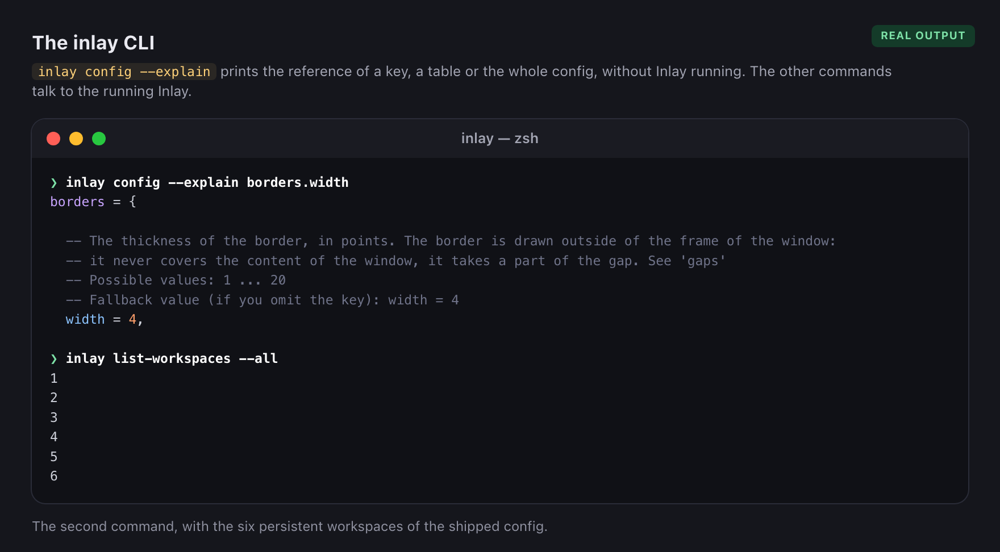</p>

**Autocompletion in your editor.** Inlay carries the types of its config for
[lua-language-server](https://luals.github.io) (the Lua extension of Zed, of VS Code, Neovim…): every key, its
values and what it does, as you type and on hover. Once, in the config folder:

```sh
inlay config --types
```

It writes `.luarc.json` next to your `inlay.lua`, pointing at
`/Applications/Inlay.app/Contents/Resources/types` (the folder of types of the app it runs from; a
`.luarc.json` that exists is printed, never overwritten). Keep it in your dotfiles. The types are made from the
reference when the app is built, so an update of Inlay updates them: nothing to run again. The functions of
`inlay` are typed, with their arguments, and so are the keys of `inlay.config` and the commands of `inlay.dsp`.

Of the keys that came from AeroSpace, the ones that were only there to read its configs are gone and are
unknown keys now: `configVersion`, `afterLoginCommand`, `accordionPadding`,
`nonEmptyWorkspacesRootContainersLayoutOnStartup`, `indentForNestedContainersWithTheSameOrientation` and
`match.duringAerospaceStartup` (`during_inlay_startup` stays). The variables `AEROSPACE_*` that your scripts get
stay.

A test fails if the config parser accepts a key that the reference does not document, or the other way round.

**Inlay follows the files.** With `auto_reload_config = true` (it is set in the built-in config; the
default of the key is `false`), Inlay reloads the config when `inlay.lua`, one of the files it requires or one
of your themes is saved, and the menu bar item and the borders show the new values right away. Creating a file that `require`
didn't find reloads it too. It works when `~/.config/inlay` is a symbolic link to a folder of yours, when a
file is a link, with editors that save by writing a new file and renaming it over the old one, and when a link
is pointed somewhere else. A save with an error (Lua that doesn't run, or a call of inlay with a wrong argument) is not
applied (the previous config stays, and a window shows the error with its file and line); the next save is
picked up as usual.
Without that key, reload by hand: `inlay reload-config` or *Reload Config* in the menu.

```lua
inlay.config({ auto_reload_config = true }) -- the built-in one. With false: reload with 'inlay reload-config' or from the menu
```

Nothing shows up on the screen after a reload: the menu says when the config was reloaded last. A
`notifications` or `settings` table of a previous version is accepted with a warning and ignored.

#### Config keys

Every key that `inlay.config({ … })` takes, by table. All of them are **snake_case**. The *Default* column is
the value in use with the built-in config of Inlay and its `material` theme (what you get without writing the
key); `inlay config --show <key>` prints the value in use and where it comes from, and
`inlay config --explain <key>` the whole documentation of a key, with its fallback value in the code.

```lua
-- Any key, alone or with others: the tables are merged key by key with the ones of Inlay
inlay.config({
  start_at_login = true,
  menu_bar = { theme = 'dms', per_monitor = true },
  borders  = { width = 3, single_window = { gap = 4 } },
})
```

**General**

| Key | Default | What it does |
|---|---|---|
| `start_at_login` | `true` | Adds Inlay to the login items of macOS (or removes it) every time the config loads |
| `auto_reload_config` | `true` | Reloads the config when one of its files is saved |
| `built_in_config` | `true` | `false`: your config alone, over the defaults of the code (no workspaces, bindings or rules of Inlay) |
| `after_startup_command` | `{}` | Commands that run after Inlay starts. Also `inlay.on('start', …)` |
| `automatically_unhide_macos_hidden_apps` | `false` | Shows again the apps hidden with `cmd-h` |
| `enable_normalization_flatten_containers` | `true` | A container with a single child is flattened |
| `enable_normalization_opposite_orientation_for_nested_containers` | `true` | A container nested in another one takes the opposite orientation |
| `default_root_container_layout` | `'tiles'` | The layout of the root container of a new workspace |
| `default_root_container_orientation` | `'horizontal'` | `horizontal` · `vertical` · `auto` (by the shape of the monitor) |
| `theme` | `'material'` | The look of the borders and of the menu bar: a name, a table, or `{ dark = …, light = … }`. Also `inlay.theme(…)`. See [Themes](#themes) |

**Callbacks** (also `inlay.on(event, …)`)

| Key | Default | What it does |
|---|---|---|
| `on_focus_changed` | `'move-mouse window-lazy-center'` | Commands that run when the focused window changes (`inlay.on('focus_changed', …)`) |
| `on_focused_monitor_changed` | `'move-mouse monitor-lazy-center'` | Commands that run when the focused monitor changes (`inlay.on('monitor_changed', …)`) |
| `on_mode_changed` | `{}` | Commands that run when the binding mode changes (`inlay.on('mode_changed', …)`) |
| `exec_on_workspace_change` | `{}` | A program and its arguments, run when the focused workspace changes (`inlay.on('workspace_changed', …)`). It gets `INLAY_FOCUSED_WORKSPACE` and `INLAY_PREV_WORKSPACE` |

**Workspaces & monitors**

| Key | Default | What it does |
|---|---|---|
| `workspaces` | 7 workspaces, `1`–`7` on `h j k l u i o` | Your workspaces: `{ id, name, key, monitor, apps }` each. Better with `inlay.workspace(…)`. Yours replace the ones of Inlay |
| `workspace_keys.focus` | `'cmd-alt-ctrl'` | Modifiers of the binding that goes to a workspace (`<focus>-<key>`). `false`: no such bindings |
| `workspace_keys.move` | `'cmd-alt-shift'` | Modifiers of the binding that moves the focused window there. `false`: no such bindings |
| `persistent_workspaces` | made from `workspaces` | Workspaces that stay alive without windows: the ones the menu bar item always shows |
| `workspace_to_monitor_force_assignment` | made from `workspaces` | Workspace = a monitor pattern (`'main'`, `'secondary'`, a number, a regex of its name) or a list of them |

**Layout: `gaps`** (in points)

| Key | Default | What it does |
|---|---|---|
| `gaps.inner.horizontal` | `8` | Between two windows side by side |
| `gaps.inner.vertical` | `8` | Between two windows one above the other |
| `gaps.outer.left` · `.right` · `.top` · `.bottom` | `8` | Between the windows and the edges of the monitor. A value can be per monitor: `{ { monitor = { main = 16 } }, 24 }` |

**Layout: `tiling`**

| Key | Default | What it does |
|---|---|---|
| `tiling.new_window_placement` | `'dwindle'` | `dwindle`: the new window splits the focused one · `after-focused`: after it, like i3 |
| `tiling.split_target` | `'focused'` | The window a new one splits: `focused` · `cursor` (the one under the mouse) |
| `tiling.split_ratio` | `0.5` | What the split window keeps: `0.1` … `0.9` |
| `tiling.startup_layout` | `'dwindle'` | How the windows open at startup are arranged: `grid` · `row` · `dwindle` |
| `tiling.min_window_size` | `100` | The smallest size, in points, that resizing leaves to a window: `20` … `500` |
| `focus_follows_mouse.enabled` | `false` | The window under the mouse cursor gets the focus |

**Animations: `animations`** (also `inlay.animation({ leaf = …, … })`)

| Key | Default | What it does |
|---|---|---|
| `animations.enabled` | `true` | Animates the tiling windows: open, close, `swap`/`move`, `fullscreen`, switching workspaces |
| `animations.duration` | `160` | Milliseconds: `0` … `500` |
| `animations.curve` | `'quint'` | `quint` · `expo` · `quick` · `ease-out` · `linear` · `ease` · `ease-in-out` · `snappy` · `overshot`, or one of `animations.curves` |
| `animations.workspace_switch` | `'horizontal'` | How switching workspaces slides the windows: `horizontal` · `vertical` · `auto` · `off` |
| `animations.open` | `{ curve = 'quint', duration = 200 }` | A new window |
| `animations.move` | `{ curve = 'quint', duration = 160 }` | The windows that make room, take the space of one that closed, or move with `swap`/`move` |
| `animations.fullscreen` | `{ curve = 'expo', duration = 220 }` | The `fullscreen` command, in and out |
| `animations.workspace` | `{ curve = 'expo', duration = 140 }` | The windows that slide when switching workspaces |
| `animations.curves` | `{}` | Curves of your own: name = `{ x1, y1, x2, y2 }`. Also `inlay.curve(…)` |

**Menu bar: `menu_bar`**

| Key | Default | What it does |
|---|---|---|
| `menu_bar.enabled` | `true` | Shows the menu bar item |
| `menu_bar.theme` | `'hypr'` | `pills` · `chips` · `hypr` · `minimal` · `dots` · `underline` · `liquid` · `dms`. See [Menu bar](#menu-bar) |
| `menu_bar.dim_empty_workspaces` | `true` | The workspaces without windows are fainter |
| `menu_bar.show_mode` | `true` | The initial of the binding mode on the focused workspace, outside of `main` |
| `menu_bar.per_monitor` | `false` | Groups the workspaces by monitor, and marks the one another monitor shows |
| `menu_bar.system_colors` | `true` (theme) | Draws the item like the other icons of the menu bar, whatever `menu_bar.colors` says |
| `menu_bar.colors.focused` | `'auto'` | The background of the focused workspace. `'#RRGGBB[AA]'` · `'system-accent'` · `'auto'` |
| `menu_bar.colors.occupied` | `'auto'` | The workspaces with windows |
| `menu_bar.colors.empty` | `'auto'` | The workspaces without windows |
| `menu_bar.colors.accent` | `'auto'` | The focus marker while it shows the binding mode (`auto`: the one of `focused`) |

**Borders: `borders`** (the colors and the glow come from the theme)

| Key | Default | What it does |
|---|---|---|
| `borders.enabled` | `true` | A border around every normal window of the visible workspaces |
| `borders.width` | `2` | Points: `1` … `20`. Drawn outside of the window, in the gap |
| `borders.corner_radius` | `16` | Points: `0` … `40`. 16 is close to macOS 26, 10 to macOS 14 and 15 |
| `borders.square_corners` | `false` | Fills the rounded corners of the windows, so that they look square |
| `borders.active_color` | theme | The focused tiling window. `'#RRGGBB[AA]'` · `'system-accent'`; `'#00000000'` is no border |
| `borders.inactive_color` | theme | The windows that aren't focused |
| `borders.floating_color` | theme | The focused floating window |
| `borders.fullscreen_color` | the color it has without fullscreen | The focused window in fullscreen |
| `borders.mode_colors` | theme | The focused window in a binding mode: mode name = color |
| `borders.glow` | theme | A halo of the color of the border around the focused window |
| `borders.glow_radius` | theme | Points: `1` … `40` |
| `borders.single_window.enabled` | `true` | A window alone in its workspace (or in fullscreen) gets a border and a gap of its own; `false`: it fills the screen |
| `borders.single_window.width` | `2` | Points: `1` … `20` |
| `borders.single_window.gap` | `2` | Points: `0` … `40`, never less than `width` |
| `borders.single_window.fullscreen_width` | the one of `width` | The border of the window in fullscreen: `1` … `20` |

**Programs: `exec`**

| Key | Default | What it does |
|---|---|---|
| `exec.inherit_env_vars` | `true` | The programs that Inlay starts inherit its environment |
| `exec.env_vars` | `PATH` with Homebrew | Variables set or replaced; `${NAME}` is the value of the variable. Also `inlay.env(name, value)` |

**Key bindings**

| Key | Default | What it does |
|---|---|---|
| `key_mapping.preset` | `'qwerty'` | The layout the names of the keys refer to: `qwerty` · `dvorak` · `colemak` |
| `key_mapping.key_notation_to_key_code` | `{}` | Names of your own for keys: `{ unicorn = 'q' }` |
| `mode.<name>.binding` | the bindings of Inlay | Keys = commands per binding mode. Better with `inlay.bind(keys, commands, { mode = … })` |

**Window rules: `on_window_detected`** (better with `inlay.window_rule(…)`)

| Key | What it does |
|---|---|
| `match.app_id` | The bundle id of the app (`inlay list-apps`) |
| `match.app_name_regex_substring` | A regex (case insensitive) in the name of the app |
| `match.window_title_regex_substring` | A regex (case insensitive) in the title of the window |
| `match.workspace` | The workspace where the window is detected |
| `match.during_inlay_startup` | `true`: only the windows open when Inlay starts; `false`: only the later ones |
| `match` (a string) | A command instead of conditions: the rule matches when it succeeds (`'test %{window-layout} ~= _tiles'`) |
| `check_further_callbacks` | `true`: the rules that follow are checked too (default `false`: the first match wins) |
| `run` | The commands for the window: a command or a list of them |

`inlay run-callback on_window_detected --for-every-window` runs the rules again for every open window.

#### Changing the config from the CLI

What the settings window did with the file, the CLI does, and then it reloads the config:

```sh
inlay config --use ~/.dotfiles/inlay        # a folder: ~/.config/inlay becomes a link to it
inlay config --use ~/Downloads/inlay.lua    # a file: its text replaces the config in use
inlay config --unlink                       # ~/.config/inlay is a folder of its own again
```

- **`--use <folder>`** links `~/.config/inlay` to the folder, with the same rules as the question of
  `install.sh`: a real `~/.config/inlay` is not deleted (it becomes `~/.config/inlay.backup-<date>`), a previous
  link is only replaced, and a folder without `inlay.lua` gets a copy of the config in use. Not with a
  `~/.inlay.lua`: a config folder would be a second config. A config split into files is best kept in a
  folder: `--use <folder>` with the folder that has them.
- **`--use <file>`** checks the file first: one with errors is not used, and nothing changes. Otherwise its
  text replaces the config in use, which is kept next to it as `inlay.lua.backup-<date>`. If the config is in
  a linked folder, the file in that folder is the one replaced (the link stays).
- **`--unlink`** makes `~/.config/inlay` a folder of its own again, with a copy of the `.lua` files of the
  linked folder; the folder it pointed to isn't touched.

**Problems are never silent.** If the config has errors or warnings, `inlay reload-config` prints them, a
window lists the errors, and the menu of the menu bar item shows "Config contains errors…" or "Config contains
warnings…". A key binding that macOS refuses to register (another app may own the same keys) is reported the
same way, as a warning that names the binding. While *Secure Input* is active (a password field is focused),
macOS delivers no key bindings to anybody: Inlay shows a shield in the corner of the screen. To check a file
without loading it:

```sh
/Applications/Inlay.app/Contents/MacOS/Inlay --check-config ~/.config/inlay/inlay.lua
```

The programs that Inlay launches receive the variables `INLAY_WINDOW_ID`, `INLAY_WORKSPACE`,
`INLAY_FOCUSED_WORKSPACE` and `INLAY_PREV_WORKSPACE` (and also under the `AEROSPACE_*` name, so that scripts
written for AeroSpace keep working).

### Gaps

The `gaps` table sets, in points, the gaps between windows (`inner.*`) and between the windows and the edges of
the monitor (`outer.*`). A key that is omitted is 0. A value can also depend on the monitor
(`outer.top = [{ monitor.main = 16 }, 24]`: see `inlay config --explain gaps`).

```lua
gaps = {
  inner = {
    horizontal = 8, -- between two windows that are side by side
    vertical = 8, -- between two windows that are one above the other
  },
  outer = {
    left = 8,
    bottom = 8,
    top = 8, -- under the menu bar
    right = 8,
  },
},
```


The window borders are drawn in the gaps: see [Window borders](#window-borders) for how the two fit together.

**A window alone in its workspace** doesn't take the outer gaps: it has a gap and a border of its own,
`borders.single_window` (see [Window borders](#window-borders)). By default a thin border of 1 point and a gap of
2 points, from the edges of the visible part of the screen; with `enabled = false`, the window fills the screen
without a border. The outer gaps and the border of `borders` come back as soon as a second tiling window joins
it, sliding like any other change of the layout. `fullscreen` looks the same. Floating windows don't count.
(`gaps.smart`, of a previous version, is accepted with a warning and ignored.)

### Tiling

A new window **splits the focused window in two**, like the *dwindle* layout of Hyprland: if the focused one is
wider than it is tall they end up side by side; otherwise, stacked. The new one goes to the right or below.
When a window is closed, its neighbor gets the space back.


```lua
tiling = {
  new_window_placement = 'dwindle', -- or 'after-focused': the behavior of AeroSpace
  split_ratio = 0.5, -- 0.1 – 0.9: fraction kept by the window that is split
  split_target = 'focused', -- or 'cursor': the new one splits the window under the cursor
  startup_layout = 'grid', -- 'grid' | 'row' | 'dwindle': the windows that were already open
  min_window_size = 100, -- 20 – 500 pt: how far `resize` and the mouse can shrink
},
```

**How much each one gets** (`split_ratio`, only with `dwindle`): the fraction of its space that the window that
is split keeps, from 0.1 to 0.9. With 0.5, two halves; with 0.6, it keeps 60% and the new window gets 40%.

```lua
tiling = {
  split_ratio = 0.5,
},
```

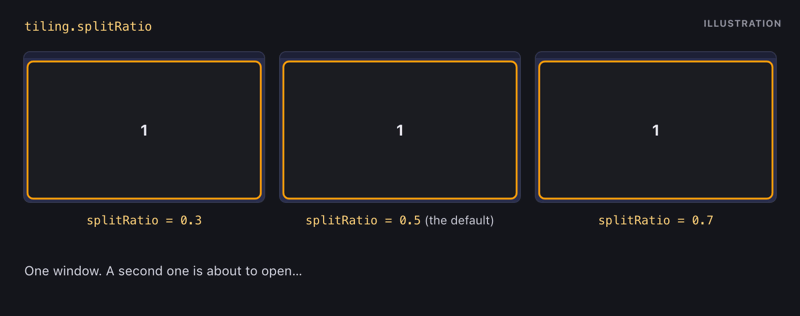

**Which window is split** (`split_target`, only with `dwindle`): with `'focused'` (the default), the focused
one; if the focused one is not tiled in that workspace, the most recent tiled one. With `'cursor'`, the tiled
window under the mouse cursor, as in Hyprland; if there is none (the cursor is in a gap, on another monitor or
over a fullscreen window, or the target workspace is not visible), `'focused'` applies. Floating windows do
not count: under a floating one, the tiled window behind it is considered.

```lua
tiling = {
  split_target = 'focused', -- or 'cursor'
},
```


**Minimum size** (`min_window_size`, 100 pt by default): the `resize` command and dragging an edge with the
mouse stop shrinking a window when it reaches that width or height, and they do not shrink the neighbors below
it either when the other one is the one growing (the neighbors that still have room give up the rest). With
the mouse, the edge that was dragged beyond it goes back to the limit on release. Reaching the limit is not an
error: `resize` exits with code 0 and no message, the same as before (it has no `--fail-if-noop`), because in
a resize mode with the key held down the limit is reached continuously. It only limits resizing: if the
windows of a workspace do not fit with that size (many windows on a small monitor, or a window split several
times), the distribution gives them less, down to the safety floor of the layout (the inner gap plus 1 pt),
and `resize` simply does not shrink them any further. `resize` always works in screen points.

```lua
tiling = {
  min_window_size = 100, -- 20 ... 500 points
},
```


The windows that **are already open when Inlay starts** (or when it is resumed with `inlay enable on`) are not
placed one by one. First the `on_window_detected` rules of the config run for each of them, exactly as for a
new window, so every window goes to the workspace of its rule (or becomes floating, or whatever the rule
says). Then the windows are distributed, workspace by workspace, according to `startup_layout`. With apps in
your `workspaces`, the terminals end up in workspace 1, the editors in 2, the browsers in 3, and so on, each
workspace with its own grid. The workspaces are arranged
once the rules of every window are over, also when macOS reports another event in the middle of the startup. The rules run once per window: later refreshes do not evaluate them again, so a
window that you move somewhere else stays there. On resume, they only run for the windows that appeared
while Inlay was paused. To run them again for all the open windows, use
`inlay run-callback on_window_detected --for-every-window` (`w` in the `service` mode of the built-in config).

| `startup_layout` | Result |
|---|---|
| `'grid'` (the default) | Balanced grid: `ceil(√n)` columns and as many rows as needed, all rows with the same height. The last row shares its width among the windows it has: 5 windows are 3 on top and 2 below; 3 are 2 on top and 1 below |
| `'row'` | A single row with all the windows at the same width |
| `'dwindle'` | No distribution: each window enters as a new window, one after another (with `new_window_placement = 'dwindle'`, a spiral with the last ones very small) |

```lua
tiling = {
  startup_layout = 'grid', -- 'grid' | 'row' | 'dwindle'
},
```


It only affects that moment. The windows you open afterwards follow `new_window_placement`, and the grid is a
normal tree: it can be moved, resized and rearranged with the usual commands. When resuming after a pause,
only the workspaces in which some window appeared while Inlay was paused are rearranged; the others keep
their arrangement.

**To arrange a workspace again** at any moment, `inlay arrange-workspace dwindle|grid|row` rebuilds its tiling
tree out of its tiling windows, in the order they have in the tree (`--workspace <name>` for another one than
the focused one). With `dwindle` they come back one after another and each one splits the previous one, like
new windows: two side by side on a wide screen, then the spiral, with `split_ratio`. `grid` and `row` are the
ones of `startup_layout`. The floating windows stay where they are. The shipped config runs
`arrange-workspace dwindle` with `cmd-alt-shift-d`: useful for a workspace that was left as a row, or with two
windows one above the other.

```lua
mode = {
  main = {
    binding = {
      ['cmd-alt-shift-d'] = 'arrange-workspace dwindle',
    },
  },
},
```

A window that leaves the tiling because macOS **minimizes** it, puts it in **native fullscreen** or **hides
its app** remembers its place (container, position, size and the neighbor that kept its space) and gets it
back when it returns:

- If its container still exists, it goes back to its position and the neighbor gives the space back.
- If the container is gone (it had only two windows and was flattened), the neighbor is split again the same way as before.
- If neither the container nor the neighbor is left, it enters as a new window.


A **minimized** window also remembers its workspace (a minimized window does not belong to any). If it is
restored while you are in another workspace, it goes back to its own and to its place, and **the focus follows
it**: Inlay switches to that workspace. If the place is no longer recoverable, it enters its workspace as a new
window. Only if its workspace no longer exists (it was not persistent and was left without windows) does it
enter as a new window in the focused workspace.

Inlay **has no *accordion* layout**. Its forms, which come from AeroSpace, are accepted with a warning (not
with an error) and are treated as `tiles`:

| In the config | In Inlay |
|---|---|
| `default_root_container_layout = 'accordion'` | `'tiles'` is used |
| `accordionPadding = 30` | Ignored |
| `layout accordion`, `layout h_accordion`, `layout v_accordion` | `layout tiles`, `layout h_tiles`, `layout v_tiles` |
| `layout tiles accordion` (toggle) | `layout tiles` |

The warnings show up in `inlay reload-config` and in the menu of the menu bar item ("Config contains warnings...").

### Moving the focus and the windows: `focus`, `swap` and `move`

**`focus left|down|up|right` (`cmd-alt` + arrow) goes to the window next to the focused one on the screen.**
AeroSpace follows the tree instead: it goes up to the closest container with something in that direction and then
down to the window of it that was focused last, which may be nowhere near. With *dwindle*, two columns whose
bottom halves are split in two, `focus left` from the top right window could land on the bottom left ones.
In Inlay it goes to the window that faces it on that side; toward a side with two windows (the two halves below),
to the one that was focused more recently, so that going back and forth returns to the same window.

The shipped config has two ways of moving the focused window with the arrows:

- **`cmd-alt-ctrl` + arrow: `swap`**. The window trades places with its neighbor and the layout keeps its
  shape: in a left column with two windows and a right one, the bottom left window moved to the right takes the
  place of the right one, and the right one goes to the bottom left. Toward a side with two windows, it swaps
  with the one that was focused more recently. At the edge of the workspace nothing happens.
- **`cmd-alt-shift` + arrow: `move`**, the one of AeroSpace. The window leaves its column or row and the layout
  changes its shape (the bottom left window moved to the right becomes a third column).

### Animations

The tiling windows **slide to their place**, in 160 ms (200 ms to open, 220 ms for fullscreen and 140 ms to switch workspaces in
the shipped config, with the `quint` and `expo` curves), when a window opens (it grows from the center of its
tile, from 87% of its size, while its neighbor makes room for it, like the *popin* of Hyprland) or closes, when a window is moved with `swap` or `move`,
and when the `fullscreen` command (`cmd-alt-shift-enter`) makes a window grow from its tile to the whole screen, or
shrink back to its tile. The native fullscreen of macOS has an animation of its own.
The borders go with them. Switching workspaces has its own slide (below). Nothing else is animated: resizing, `balance-sizes`, the
startup and the mouse stay instant. With *Reduce motion* (System Settings → Accessibility → Display) nothing is
animated.

**Switching workspaces** slides the windows too, in the same duration: the windows of the workspace you leave
go out by one side of the screen and the ones of the workspace you go to come in by the other. Toward a later
workspace (in the order of the menu bar item) they move to the left, toward an earlier one to the right. Only
the tiling windows slide: the floating ones appear and disappear as before.

The windows never cross another screen. `workspace_switch` picks the direction, and each screen that switches
workspace applies it as far as the screens around it allow:

| `workspace_switch` | No screen around | A screen on one side | Screens on both sides | A screen below |
|---|---|---|---|---|
| `'horizontal'` (default) | Side to side | In and out by the free side | No slide | Side to side |
| `'vertical'` | Through the bottom | Through the bottom | Through the bottom | No slide |
| `'auto'` | Side to side | Through the bottom | Through the bottom | Side to side |

Through the bottom means out downwards and in from below: macOS doesn't let a window above the menu bar, so the
top of a screen can't be used. `'off'` turns the slide off and keeps the other animations.

```lua
animations = {
  enabled = true,
  duration = 180, -- 0 ... 500 milliseconds. 0 = no animation
  workspace_switch = 'horizontal', -- 'horizontal' | 'vertical' | 'auto' | 'off'
},
```

macOS only lets Inlay move the windows of other apps through the Accessibility API, one frame at a time, and
it doesn't let it change their opacity or scale without disabling SIP: the animation moves and resizes the
windows, nothing more. A window that is slow to resize (some browsers, Electron apps) skips frames, but it
always ends in its exact place.

**Curves**: how the movement is spread over the duration, a cubic Bézier curve like the `bezier` of Hyprland. The
presets are `quint` (the default: easeOutQuint, the curve of the windows in Hyprland and Omarchy), `expo`
(easeOutExpo), `quick` (the one of Hyprland), `ease-out` (the curve of before), `linear`, `ease`, `ease-in-out`, `snappy` and
`overshot` (the window goes a bit past its frame and comes back); `animations.curves` adds your own. Each kind
of animation can have its own curve and duration: `open` (a new window), `move` (the others make room or take the
space, `swap`, `move`), `fullscreen` and `workspace`.

```lua
animations = {
  curve = 'ease-out',
  open = { curve = 'overshot', duration = 220 },
  workspace = { curve = 'snappy', duration = 160 },

  curves = {
    bounce = { 0.34, 1.56, 0.64, 1 }, -- x1, y1, x2, y2. x1 and x2 in 0 ... 1
  },
},
```

A curve that overshoots also resizes the window past its tile for a moment: some apps are slow to redraw that.

## Menu bar

The menu bar item shows **all the workspaces** and marks the focused one (it does not distinguish monitors). It
is configured in the `menu_bar` table of the config; `inlay config --explain menu_bar` documents it.

<p align="center">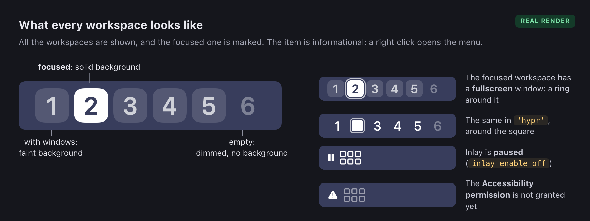</p>

| Key | Values | Default |
|---|---|---|
| `enabled` | `true`, `false` | `true` |
| `theme` | `'pills'`, `'chips'`, `'hypr'`, `'minimal'`, `'dots'`, `'underline'`, `'liquid'`, `'dms'` | `'liquid'` |
| `dim_empty_workspaces` | `true`, `false` | `true` |
| `show_mode` | `true`, `false` | `true` |
| `per_monitor` | `true`, `false` | `false` |
| `system_colors` | `true`, `false` | `false` |
| `menu_bar.colors` `accent`, `focused`, `occupied`, `empty` | color or `'auto'` | `'auto'` |

**`theme`**: the shape of the item.

```lua
menu_bar = {
  theme = 'liquid', -- 'pills' | 'chips' | 'hypr' | 'minimal' | 'dots' | 'underline' | 'liquid' | 'dms'
},
```

**Pick a theme** from this gallery: each one as Inlay draws it, on a dark and on a light menu bar, with
workspace 2 focused and 6 empty. Copy its line into `menu_bar`.

<table>
<tr><td valign="middle"><code>'liquid'</code><br><sub><b>the default</b>: a dot per workspace, and a drop with the name of the focused one</sub></td><td>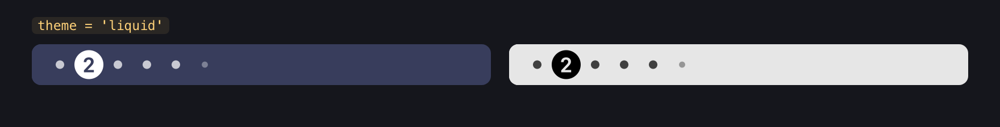</td></tr>
<tr><td valign="middle"><code>'pills'</code><br><sub>round workspaces, and the focused one a wider pill</sub></td><td>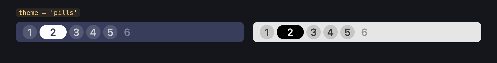</td></tr>
<tr><td valign="middle"><code>'chips'</code><br><sub>the workspaces alone, as rounded squares</sub></td><td>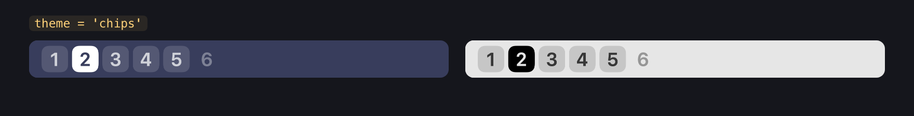</td></tr>
<tr><td valign="middle"><code>'hypr'</code><br><sub>the names, and a square in place of the focused workspace</sub></td><td>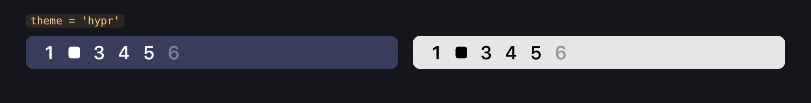</td></tr>
<tr><td valign="middle"><code>'minimal'</code><br><sub>only the focused workspace</sub></td><td>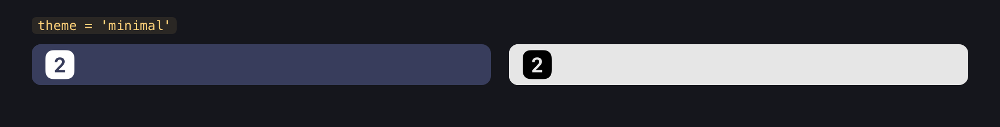</td></tr>
<tr><td valign="middle"><code>'dots'</code><br><sub>a dot per workspace, a ring if it is empty, and the focused one a pill</sub></td><td>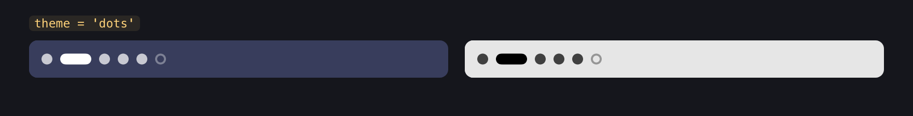</td></tr>
<tr><td valign="middle"><code>'underline'</code><br><sub>the names, and a bar under the focused one</sub></td><td>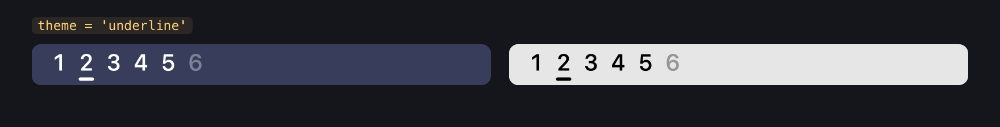</td></tr>
<tr><td valign="middle"><code>'dms'</code><br><sub>round workspaces on a track, and the focused one a pill with its name</sub></td><td></td></tr>
</table>

When the focus moves, the marker slides from the workspace it leaves to the new one (not in `minimal`). Some of
the themes taken from Hyprland setups move in their own way: the pill of **`dots`** stretches on its way,
like the page indicator of iOS; the bar of **`underline`** leaves by its leading edge, stretches towards the
new workspace and then shrinks into it; and the drop of **`liquid`** flows to the new workspace with a trail
behind it that catches up at the end. The pills of **`dms`** make room for each other, and the track follows
them. With "Reduce motion" nothing slides.

**`hypr`** is the workspace indicator of the [Monitor Workspaces](https://github.com/vadim-su/omarchy-monitor-workspaces)
plugin of the Omarchy bar: the names in slots of the same width, and a square in place of the focused one. It
is made for `per_monitor`: a frame goes around the name of the workspace that another monitor shows, and a bolder
line divides the monitors.

**`dms`** is the workspace switcher of [Dank Material Shell](https://github.com/AvengeMedia/DankMaterialShell)
(Quickshell, Material 3): small round workspaces on a tonal track, and the focused one a wider pill with its
name. With `'auto'` colors it follows the menu bar like every theme; Material 3 colors suit it, and with
`per_monitor` each monitor gets its own track instead of a line.

```lua
menu_bar = {
  theme = 'dms',
  colors = {
    focused = '#D0BCFF', -- primary
    occupied = '#CCC2DC', -- secondary
    empty = '#938F99', -- outline, and the track at 16%
    accent = '#EFB8C8', -- tertiary
  },
},
```

**`per_monitor`** groups the workspaces by the monitor they are on, from left to right, with a line between
the monitors, and draws a hollow marker on the workspace that another monitor shows. With a single monitor it
changes nothing. Every theme supports it, and it is off by default.

```lua
menu_bar = {
  per_monitor = true,
},
```

<p align="center">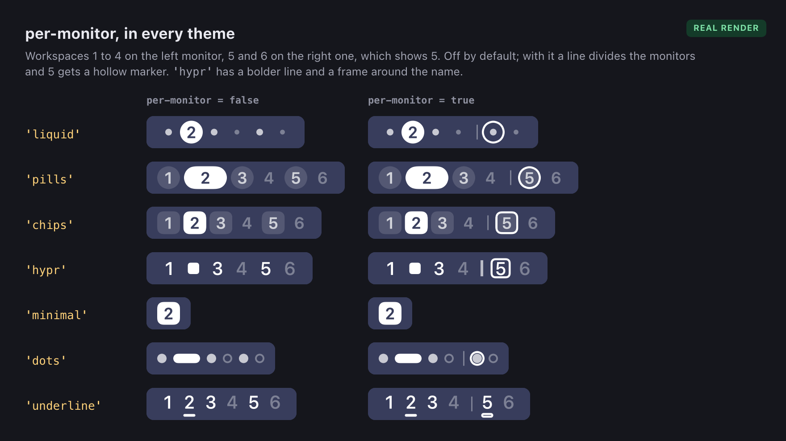</p>

The item shows no app icons. `theme = 'chips-icons'` and the `show_app_icons` key, of a previous version, are
still accepted so that a config that has them loads: they give a warning, the theme is treated as `'chips'`
and the key is ignored.

**`system_colors`**: draws the item like the other icons of the menu bar, whatever theme is in use and
whatever `menu_bar.colors` says: in the color of the menu bar text, as an image that macOS colors itself. The
colors of `menu_bar.colors` stay in the file, and apply again with `false`.

```lua
menu_bar = {
  system_colors = true,
},
```

**Colors**: they come from a theme (see [Themes](#themes)), and each one can be set on its own: the ones of the
item in `menu_bar.colors` (below) and the ones of the borders in `borders`. What you set wins over the theme.

**`dim_empty_workspaces`, `show_mode`**: what the item shows besides the names. With
`enabled = false` there is no item at all, and Inlay keeps working with the key bindings and the CLI; opening
Inlay again from Applications opens the config in an editor.

```lua
menu_bar = {
  enabled = true,
  dim_empty_workspaces = true,
  show_mode = true, -- the initial of the binding mode on the marker of the focused workspace
},
```

With `show_mode = true`, while the binding mode is not `main` (`resize`, `service`…), **the marker of the
focused workspace carries the initial of the mode**, the way Aeromenu did it. In `chips` and `minimal` the
initial takes the place of the name in the chip; in `hypr` the square grows from 8.5 to 14 pt to hold it.
In `dots` the pill grows taller to hold it, in
`underline` the initial takes the place of the name and in `liquid` the drop shows it.
Nothing is added next to the workspaces, so the item is exactly as wide in every mode and nothing in the menu
bar moves. While a window of the workspace is fullscreen, a ring goes around the marker, which stays filled,
in every theme. The key governs every theme.

<p align="center">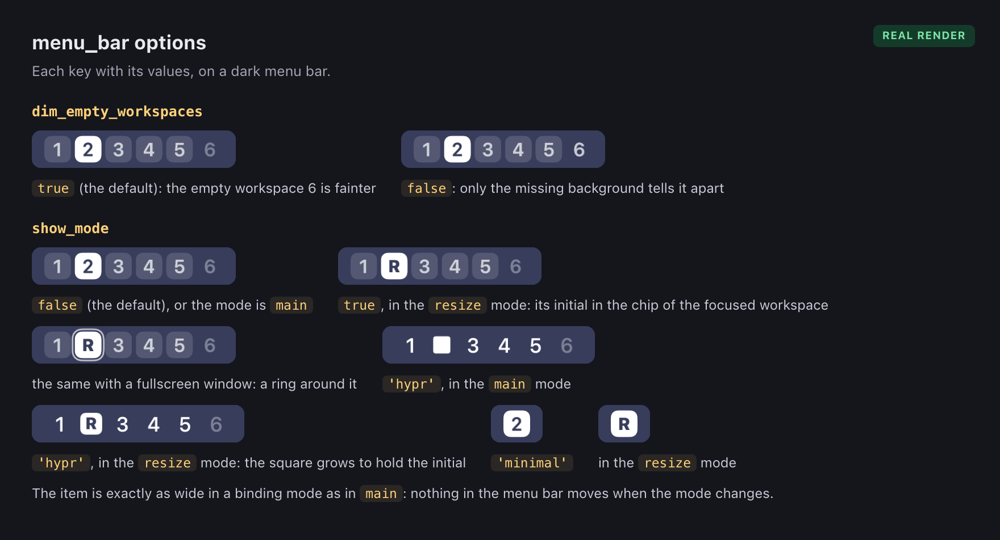</p>

**`menu_bar.colors`**: a color is `'#RRGGBB'`, `'#RRGGBBAA'` or `'system-accent'`. `'auto'` is the color of
the menu bar text (white on a dark bar, black on a light one). With everything set to `'auto'`, the
item is a template image identical to the one of Aeromenu, also while it shows a binding mode; a fixed color
does not adapt to the bar. `accent` is the color of the marker while it shows the binding mode: `'auto'` is
the same as `focused`, and over a fixed color the initial is white, or black if the color is light.

```lua
menu_bar = {
  colors = {
    accent = 'auto', -- the marker of the focused workspace while it shows the binding mode
    focused = 'auto', -- the background of the focused workspace
    occupied = 'auto', -- the workspaces with windows: the name and, at 16%, its background
    empty = 'auto', -- the workspaces without windows
  },
},
```

<p align="center"></p>

**The item and its menu**

<p align="center">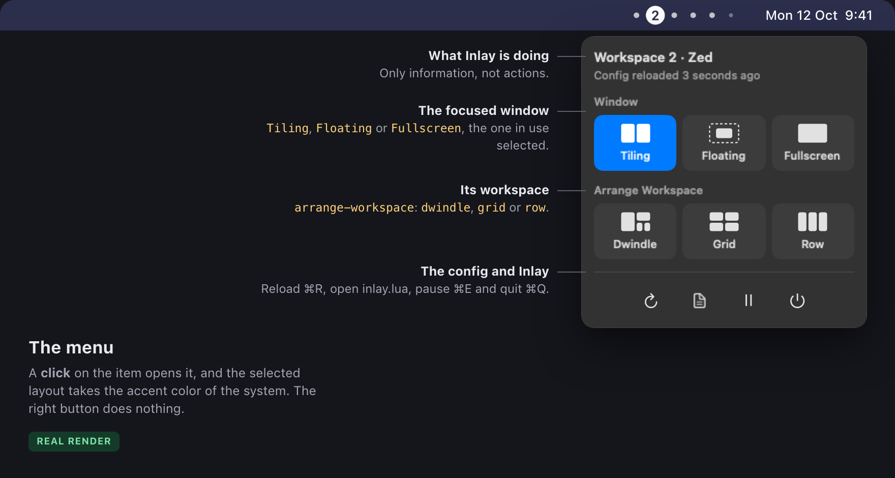</p>


- A **click** on the item (the left button) opens the menu: the layout of the focused window and of its
  workspace, the config and pause. A click on the item while it is open, a click anywhere else or Esc
  closes it. The right button and a ctrl-click do nothing. With
  VoiceOver, "pressing" the item (VO-space) opens the menu. To switch workspace: the key bindings or the CLI.
  The button never gets to see the mouse (a transparent view on top of it takes it), and the menu pops up
  below the item without highlighting it: no rounded background behind the item. A ⌘-drag still moves the
  item along the bar.
- The menu is a **panel** with the material of the menus, and what is selected or under the mouse takes the
  **accent color of the system** (there is nothing to configure). At the top, only information: the focused
  workspace and the app of the focused window (*Workspace 2 · Zed*), the binding mode and the key that leaves it
  when it isn't `main`, and when the config was reloaded last. When the last load had errors or warnings, a box
  says so (a click shows them all) with the first ones. Then **Window**: *Tiling*, *Floating* and *Fullscreen*,
  drawn, the one in use selected (disabled without a focused window). They run the commands of the key bindings
  (`fullscreen` toggles, like `cmd-alt-shift-enter`) once the menu is closed; *Fullscreen* tiles a floating window
  first, so that it looks like with the key binding: like a window alone in its workspace
  (`borders.single_window`). Then **Arrange Workspace**: *Dwindle*, *Grid* and *Row* run `arrange-workspace` on
  the focused workspace. Last, a row of buttons with a tooltip each: *Reload Config* (⌘R), *Open inlay.lua…*,
  *Pause Inlay* (⌘E) and *Quit Inlay* (⌘Q). Paused, the title says so and the layouts are
  disabled; without the Accessibility permission the menu only has the button that asks for it, and *Quit*. Switching workspaces, moving a window, balancing the sizes (`cmd-alt-shift-b`) and
  the binding modes are done with the key bindings. **The menu does not show the key bindings of your config**:
  its own shortcuts only exist while it is open.
- The built-in config defines **7 persistent workspaces** (1–7, see `workspaces` in
  [Configuration](#configuration)), which are the ones the item always shows. In yours, leaving one without
  apps (like 7) keeps a free workspace, on the main display (`cmd-alt-ctrl-o`, and `cmd-alt-shift-o` to move a window there). Any
  other workspace exists (and appears in the item) while it has windows or is the visible one.
- **There is no Settings window**: every key is in the file (*Open inlay.lua…* opens it), and Inlay reloads it
  when it is saved. Opening Inlay again from Applications opens it too, which is the way back to it when the
  item is hidden. To switch or export the config: [Changing the config from the CLI](#changing-the-config-from-the-cli).

## Themes

A theme is the look of the window borders and of the menu bar item: their colors, picked to go together, the glow
of the borders and whether the item takes the colors of the system. One line of the config picks it:

```lua
theme = 'tokyo-night',
```

Inlay ships with eight. `material` is the theme of a config without the key: Material You, with the menu bar
item drawn like the other icons of the menu bar (`system_colors`). The other seven are the most used themes of
Omarchy and of Hyprland setups, from the palette of the Omarchy theme of the same name:

| Theme | Active | Inactive | Floating | Fullscreen | `resize` · `service` modes |
|---|---|---|---|---|---|
| `'material'` (without the key) | `#B59DF7` | `#999D9F` | `#EFB8C8` | (active) | (active) |
| `'tokyo-night'` | `#7AA2F7` | `#414868B3` | `#BB9AF7` | `#FF9E64` | `#9ECE6A` · `#F7768E` |
| `'catppuccin'` (Mocha) | `#CBA6F7` | `#45475AB3` | `#89B4FA` | `#FAB387` | `#A6E3A1` · `#F38BA8` |
| `'gruvbox'` | `#D8A657` | `#504945B3` | `#7DAEA3` | `#E78A4E` | `#A9B665` · `#EA6962` |
| `'nord'` | `#88C0D0` | `#4C566AB3` | `#B48EAD` | `#EBCB8B` | `#A3BE8C` · `#BF616A` |
| `'everforest'` | `#A7C080` | `#475258B3` | `#D699B6` | `#DBBC7F` | `#83C092` · `#E67E80` |
| `'kanagawa'` | `#E6C384` | `#54546DB3` | `#957FB8` | `#FFA066` | `#98BB6C` · `#C34043` |
| `'rose-pine'` (Dawn, light) | `#286983` | `#9893A580` | `#907AA9` | `#EA9D34` | `#56949F` · `#B4637A` |

In the menu bar, the seven color the focused workspace (with the active color, and with the floating one while a
binding mode is shown on it). The other workspaces stay `'auto'`: macOS turns the text of the menu bar light or
dark to match the wallpaper, and `'auto'` follows it.

**The wallpaper is not part of a theme.** Pick it in System Settings as always: Inlay never reads it nor
changes it, so changing it, a second display or a dynamic wallpaper have nothing to do with the theme.

**Keep the look in themes.** The values of the theme go under the tables `borders` and `menu_bar` of the config:
a value that the config sets replaces the one of the theme, and one that neither sets keeps its default. The
built-in config sets none of them, so the theme is all there is; set one in the config only to override it.
`theme = {}` is no theme at all: the defaults of every key.

```lua
theme = 'nord',
borders = { active_color = '#ECEFF4' }, -- the rest of the colors, from Nord
```

**A theme of your own** is a file `themes/<name>.lua` next to `inlay.lua`, with the shape of the config and
the look only: `borders` (`active_color`, `inactive_color`, `floating_color`, `fullscreen_color`, `mode_colors`,
`glow`, `glow_radius`) and `menu_bar` (`system_colors`, `colors`). It can start from another theme with `extends`, and it takes the place of a theme of Inlay
with the same name. Saving it reloads the config, like any file of the config.

```lua
-- ~/.config/inlay/themes/mio.lua
return {
  extends = 'nord', -- optional
  borders = { active_color = '#E06C75', floating_color = '#C678DD', glow = true },
  menu_bar = { colors = { focused = '#E06C75' } },
}
```

```lua
theme = 'mio',
-- or the same table, written in the config:
theme = { extends = 'nord', borders = { active_color = '#E06C75' } },
```

What a theme doesn't set keeps its default (not the one of `material`): a theme with only `active_color` leaves
the inactive borders gray. A key that isn't one of those is an error, and the rest of the theme still applies.

**A theme for each appearance** of macOS: Inlay switches between them when macOS goes light or dark, without
reloading the config.

```lua
theme = { dark = 'tokyo-night', light = 'rose-pine' },
```

A name that isn't a theme (`theme = 'nordd'`) is a warning in the menu, with the list of themes, and the colors
are the defaults. The themes of Inlay are in [`themes/`](./themes), and `inlay config --explain theme` sums
all of this up.

## Window borders

Inlay draws a colored border around each managed window (tiled or floating) of the visible workspaces. The
color comes from the state the manager already knows, with no focus heuristics. It is configured in the
`borders` table (`inlay config --explain borders` documents it).

<p align="center"></p>

| Key | Values | Default |
|---|---|---|
| `enabled` | `true`, `false` | `true` |
| `width` | 1 … 20 (points) | `4` |
| `corner_radius` | 0 … 40 (points) | `16` |
| `square_corners` | `true`, `false` | `true` |
| `active_color` | color | `'system-accent'` |
| `inactive_color` | color | `'#8E8E9373'` |
| `floating_color` | color | `'#BF5AF2'` |
| `fullscreen_color` | color | the color without fullscreen |
| `glow` | `true`, `false` | `false` |
| `glow_radius` | 1 … 40 (points) | `12` |
| `borders.single_window` `enabled` | `true`, `false` | `true` |
| `borders.single_window` `width` | 1 … 20 (points) | `1` |
| `borders.single_window` `gap` | 0 … 40 (points), never less than its `width` | `4` |
| `borders.single_window` `fullscreen_width` | 1 … 20 (points): the border of the window in fullscreen | its `width` |
| `borders.mode_colors` `<mode>` | color | empty table |

**The colors.** The image above shows them all.

```lua
borders = {
  enabled = true,
  active_color = 'system-accent', -- the focused window, if it is tiled
  inactive_color = '#8E8E9373', -- the windows that are not focused. '#00000000': no border
  floating_color = '#BF5AF2', -- the focused window, if it is floating
  fullscreen_color = '#FF9E64', -- the focused window in fullscreen. Without it: the color it would have

  -- the focused window while a binding mode is active
  mode_colors = {
    resize = '#30D158',
  },
},
```

**`width`**: the thickness, outside of the window.

```lua
borders = {
  width = 4, -- 1 ... 20 points
},
```

<p align="center">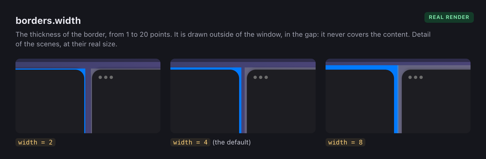</p>

**`corner_radius`**: tuned by eye, because macOS does not let Inlay read the radius of the windows of other apps.

```lua
borders = {
  corner_radius = 16, -- 0 ... 40 points. The radius of the corners of the windows
},
```

<p align="center">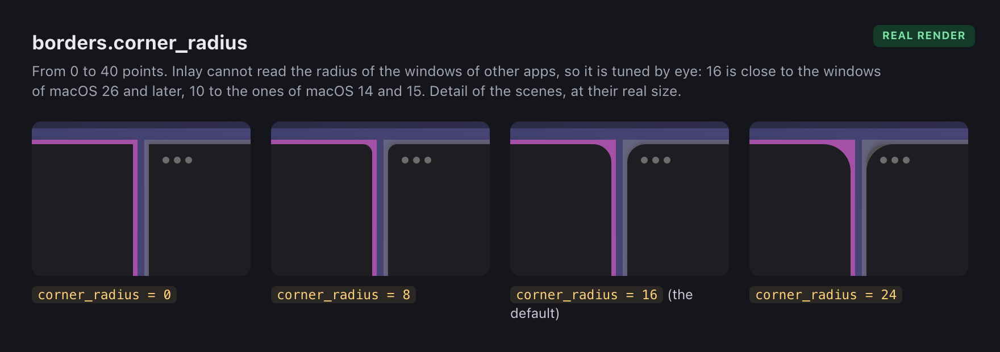</p>

**`square_corners`**: the windows of macOS have rounded corners, and Inlay can't change them (that would need
System Integrity Protection disabled). What it can do is fill them: the outer edge of the border is square, and
its inner edge follows the corners of the window, so the corners that the window leaves empty take the color of
the border and the window looks square. It applies to every window with a border: focused, not focused and
floating.

```lua
borders = {
  square_corners = true, -- false: the border follows the rounded corners of the windows
  corner_radius = 16, -- the radius of the windows, or a bit more
},
```

Keep `corner_radius` at the radius of the windows or a bit above it: with less, a bit of what is behind the
window shows in its corners. A border with a translucent color, like the default `inactive_color`, fills the
corners with that same translucent color, and a window without a border keeps its round corners. The shadow of
the window, which macOS draws, stays round.

**`glow` and `glow_radius`**: a halo around the focused window.

```lua
borders = {
  glow = true,
  glow_radius = 12, -- 1 ... 40 points
},
```

<p align="center">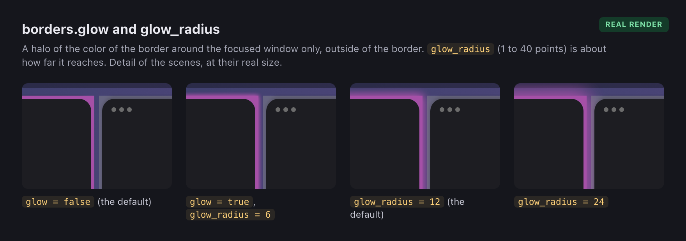</p>

**`borders.single_window`**: the tiling window alone in its workspace, and the window in fullscreen (the
`fullscreen` command, also with other windows behind it), look the same: a border of their own, in the colors of
the other borders (active, inactive, floating, the binding mode), and a gap around the window, from the edges of
the visible part of the screen. The gap is never narrower than the border, so that the edge of the screen doesn't
cut it. `fullscreen_width` gives the window in fullscreen a border of its own (without it, `width`), and its gap
grows with it. With `enabled = false` they fill the screen, without a border. Floating windows don't count and keep their
border; a floating window made fullscreen looks like the others. `fullscreen --no-outer-gaps` fills the screen
without a border. (`hide_when_single`, of a previous version, is accepted
with a warning and ignored.)

```lua
borders = {
  single_window = {
    enabled = true,
    width = 1, -- 1 ... 20 points
    gap = 2, -- 0 ... 40 points, never less than 'width'
    fullscreen_width = 4, -- 1 ... 20 points: the border in fullscreen. Without it, 'width'
  },
},
```

**Borders and gaps**: the border takes a part of the [gap](#gaps).

```lua
gaps = {
  inner = {
    horizontal = 8, -- at least twice borders.width leaves air between two borders
  },
},
borders = {
  width = 2,
},
```

<p align="center">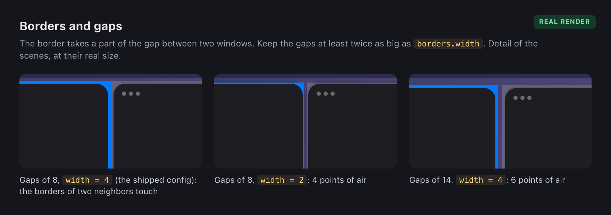</p>

The details:

- **Color of the focused window**: the one of the active binding mode if it has an entry in
  `borders.mode_colors`; otherwise, `fullscreen_color` if it is in fullscreen and the key is set; otherwise,
  `floating_color` if it is floating; otherwise, `active_color`. The other windows use `inactive_color`.
- A **fully transparent** color (`'#00000000'`) means "no border": with
  `inactive_color = '#00000000'` only the active window has a border.
- A **fullscreen** window (the `fullscreen` command) keeps its border. Where the outer gaps leave no room for
  it, as with `fullscreen --no-outer-gaps`, it is drawn just inside of the screen.
- **No border**: windows in the native fullscreen of macOS, the tiled windows that a fullscreen window covers,
  minimized windows, windows of hidden apps, popups, the ones of non-visible workspaces, and the window you are
  dragging or resizing with the mouse (the border comes back on release).
- **Dialogs and sheets, no border**: only normal windows, tiled or floating, have a border. What Inlay
  detects as a dialog (the same AeroSpace heuristics that decide which window becomes floating on its own:
  open and save panels, sheets, windows without a fullscreen button…) has no border. A normal window that you
  make floating (`layout floating`, or an `on_window_detected` rule) does have one. If you turn a dialog into
  a tiled window it has a border while it is tiled. With a dialog focused, no window has the color of the
  active one.
- The border goes **outside** the window frame, in the gap between windows: it does not cover content and does
  not receive clicks. The `gaps` should be at least twice the `width`; with smaller gaps the borders of two
  neighboring windows touch or overlap. The shipped config has gaps of 8 and the default border of 4, so
  neighboring borders touch: lower `width` to 2 or 3, or raise the gaps, to leave air between them.
- **Glow** (`glow = true`): a glow in the color of the border around the **focused** window (with whatever
  color applies to it: active, floating or mode), which fades outwards over about `glow_radius` points.
  Unfocused windows never have it. It is exterior: it is not drawn under the border or over the window, but it
  is drawn over whatever is around it (the gap and, if it is wider than the gap, the edge of the neighboring
  windows). It does not receive clicks. It is a small image that Core Animation stretches, so moving or resizing
  redraws nothing.
- The corner radius is fixed: macOS does not let you read the one of other apps' windows. Adjust it by eye.
- The borders disappear when Inlay is paused (`inlay enable off`), on quit and with `enabled = false`.
- **Colors per mode**: `borders.mode_colors` has a color for each binding mode of your config
  (`mode.<name>.binding`); a mode without one uses the active color. The `main` mode needs none: it is the mode
  that is always active, and a color of its own would replace `active_color` and `floating_color` for good,
  which exist for that purpose (you can still write `main = '…'`).

Each border is a window of Inlay's own, transparent, placed right above its window in the stacking order, so
a floating window of another app covers the borders of the windows behind it. All with public AppKit API;
there is no JankyBorders code and SkyLight is not used.

## Troubleshooting

Inlay only works when something happens (a window appears, the focus changes, a key binding runs): at rest it
uses about 0 % of the CPU. If it keeps using CPU with nothing going on, two commands tell what it is busy with:

```sh
inlay debug-stats --watch 5               # counters of what Inlay does, printed every 5 s (ctrl-c to stop)
sample Inlay 5 -file ~/inlay-sample.txt   # where the CPU time goes (it comes with macOS)
```

`inlay debug-stats` prints, for every counter, the total since Inlay started and what was counted since the
previous call (`new`, and `per-sec`). It only reads counters that Inlay keeps in memory, and the server answers
it without refreshing anything, so asking does not change the numbers. Leave the Mac alone while it runs: at
rest every `per-sec` should be 0. The one that is not tells what is going on:

| Counter | What it counts |
|---|---|
| `session.complete.*`, `session.light.*` | Refresh sessions: Inlay asks every app for its windows and lays them out |
| `session.trigger.*` | What started each session: `ax.AXMoved` (a window moved), `workspace.NSWorkspaceDidActivateApplicationNotification`, `hotkey`, `cli.<command>`... |
| `ui.publish` | Times the menu bar and the borders were told that something may have changed |
| `menu_bar.snapshot.changed` / `.same` | Whether that changed what the menu bar item shows |
| `menu_bar.draw.request.*` | Who asked to draw the item: `appearance` (the menu bar behind it), `system_colors`, `screens` |
| `menu_bar.draw.drawn` / `.skipped-same` | Images really drawn, and requests that needed none |
| `borders.op.*`, `borders.restack.*`, `borders.settle` | Borders created, moved, recolored, removed and reordered, and the checks that follow a refresh |
| `config.watcher.*`, `config.load` | Events of the config file watcher, and loads of the config |

## Uninstallation

Installed with Homebrew:

```sh
brew uninstall --cask inlay
```

It quits Inlay and removes the app and the CLI link; your config is kept. `--zap` also removes the logs. To also
remove the Accessibility entry: `tccutil reset Accessibility com.dehv.inlay`.

Installed with `install.sh`:

```sh
inlay uninstall           # pick what to remove in a list, see what is removed and what is kept, confirm
inlay uninstall --purge   # everything starts checked in the list (but the Accessibility entry)
inlay uninstall --yes     # no questions: the app, the CLI link, the login item and your config
```

<p align="center">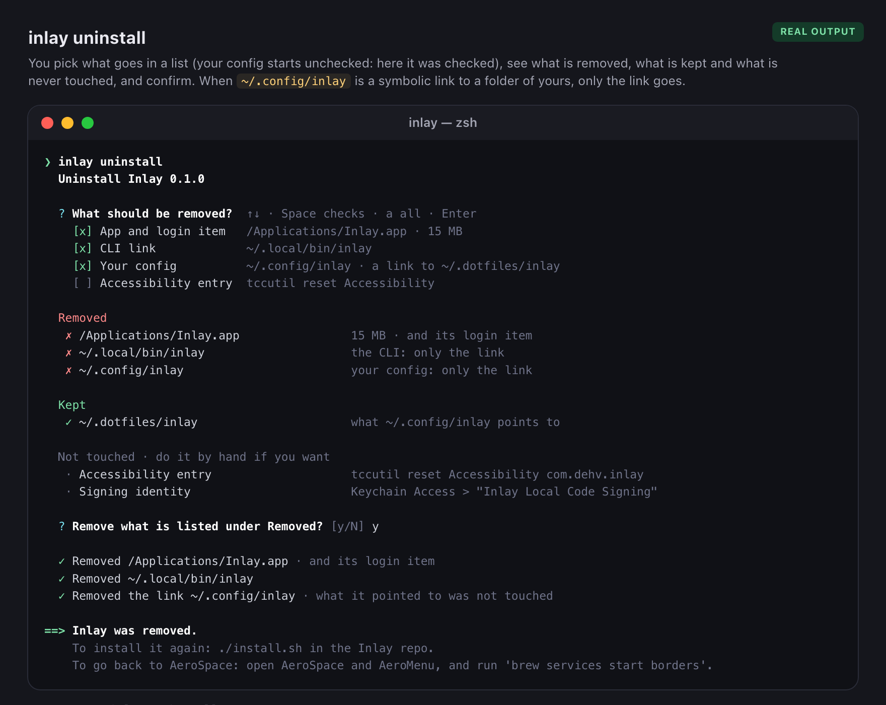</p>

First it asks **what to remove**, in a list of checkboxes (Space checks and unchecks, `a` all of them, Enter is
done): the app and its login item, the CLI link, your config, the config backups of `install.sh`, the
preferences and runtime files of the app, and its Accessibility entry. Only what exists is listed. **The app
and the CLI link start checked; your config does not**: check it to remove it. With `--purge` everything starts
checked but the Accessibility entry. Then it lists, in three groups, what is **removed** (with the size of the
app), what is **kept** (including what a removed link points to) and what it **never touches** (the signing
identity, and the Accessibility entry if it is not checked, each with how to remove it by hand), and asks
`Remove what is listed under Removed? [y/N]`. Without a terminal that shows colors the list is one question per
line.

`--yes` skips both questions (and is required when there is no terminal to answer on): it removes the app, the
CLI link, the login item and your config, and with `--purge` the preferences, the runtime files and the config
backups too. It works whether Inlay is running or not: a running Inlay is quit
first, and on quit it brings the windows of the non-visible workspaces back to the screen. The command
removes the app that contains it, so it runs from a temporary copy of the uninstall script, which deletes
itself at the end.

It removes the app that the `inlay` you ran belongs to, and the copies in `/Applications` and in
`~/Applications`; with `INSTALL_DIR=…` it looks in that folder instead of those two.

Your config is `~/.config/inlay` and `~/.inlay.lua` (or the `~/.inlay.toml` of Inlay 0.2). When it is removed:

- a real folder or file is **saved first in `~/inlay-config-<date>.tar.gz`**, and then deleted;
- `~/.config/inlay` is a **symbolic link** to a folder of yours: **only the link is removed**. The folder it
  points to and its files are never touched, and the list names that folder as kept;
- a link inside of a real `~/.config/inlay` (a config file linked by a previous version) goes with the
  folder; the file it points to is never touched.

The config backups are the ones that `install.sh` made outside of the config folder
(`~/.config/inlay.backup-<date>`, `~/.inlay.lua.backup-<date>`, `~/.inlay.toml.backup-<date>`; a backup that is
a link is removed as a link).

`./uninstall.sh` in the repo does the same (it is the same script, with the same options), for when the CLI
is not at hand.

It touches nothing of AeroSpace, AeroMenu or `borders`: to go back to them, open AeroSpace and AeroMenu and run
`brew services start borders`.

The Accessibility entry is only removed when it is checked (`tccutil reset Accessibility
com.dehv.inlay`). The signing identity is never removed: delete it in *Keychain Access* if you want.

## Development

```sh
scripts/build-app.sh    # builds and leaves a signed build/Inlay.app (installs nothing)
scripts/test.sh         # runs the tests (accepts the arguments of 'swift test', e.g. --filter DwindleTest)
scripts/make-icon.sh    # regenerates Support/AppIcon.icns from scripts/icon/AppIcon.swift
scripts/make-docs-images.sh   # regenerates the images of this page in docs/images
```

To see the menu bar item without starting Inlay, `--render-menu-bar` draws it off screen (each theme, on a
dark and a light bar, with default and custom colors; `_sheet.png` gathers them all), and the menu that it opens
(`menu-*.png`, in every state), and exits:

```sh
build/Inlay.app/Contents/MacOS/Inlay --render-menu-bar /tmp/inlay-item
build/Inlay.app/Contents/MacOS/Inlay --render-menu-bar /tmp/inlay-item-6x 6   # enlarged: 6 pixels per point
```

The same goes for the borders. `--render-borders` draws them off screen in each state, and `--debug-borders`
shows them for real for a few seconds around the windows that are on screen (without moving anything and
without the Accessibility permission), prints how they ended up stacked and removes them:

```sh
build/Inlay.app/Contents/MacOS/Inlay --render-borders /tmp/inlay-borders
build/Inlay.app/Contents/MacOS/Inlay --debug-borders 5
```

The scripts force `DEVELOPER_DIR=/Library/Developer/CommandLineTools` even if `xcode-select` points to Xcode,
to guarantee that the project does not depend on it. To build by hand:

```sh
DEVELOPER_DIR=/Library/Developer/CommandLineTools swift build
DEVELOPER_DIR=/Library/Developer/CommandLineTools swift test
```

The tests use Swift Testing (XCTest does not come with the Command Line Tools, and no XCTest target is left).
All the suites are nested in `InlayTests` (`extension InlayTests { @Suite @MainActor struct FooTest { ... } }`),
which is `.serialized`: the tests share the global model and cannot run in parallel.

**The images of this page** are made by `scripts/make-docs-images.sh` from the sources in
[`docs/images/src`](./docs/images/src): the real renders come from the two `--render-*` options above; the
sheets that gather them and the illustrations are HTML pages that a headless Google Chrome turns into PNG files;
and the animations are HTML pages too, whose frames `docs/images/src/gif.swift` (built with the Command Line
Tools) assembles into GIF files. Nothing is installed, and Inlay is not started. The renders show the accent
color of the Mac they are made on, and the illustrations use generic windows: no icons and no names of real apps. `scripts/make-docs-images.sh hero gaps`
regenerates only those images, and `--no-build` skips the build of `build/Inlay.app`.

To find out what Inlay would say about any config file without installing or starting anything (errors and
warnings of the real parser):

```sh
build/Inlay.app/Contents/MacOS/Inlay --check-config ~/.dotfiles/inlay/inlay.lua
```

| Path | Contents |
|---|---|
| `Sources/InlayApp` | Entry point of the app (the `InlayApp` product, which in the bundle is `Contents/MacOS/Inlay`) |
| `Sources/AppBundle` | The window manager: tree, commands, configuration, server, interface |
| `Sources/Cli` | The `inlay` CLI (client of the `/tmp/com.dehv.inlay-$USER.sock` socket) |
| `Sources/Common` | Code shared by the app and the CLI |
| `Sources/BuildInfo` | Version and git hash, which `build-app.sh` passes through environment variables |
| `Sources/PrivateApi` | Header of `_AXUIElementGetWindow` |
| `builtin-config.lua` | The built-in config: the base of the config of the user, and the config in use without one |
| `inlay.lua` | The short config of a new install: what `install.sh` copies, and what the app creates without a config |
| `themes` | The themes of Inlay (`theme = '<name>'`) |
| `Sources/CLua` | Lua 5.4, which runs the config (`LuaConfigLoader`) |
| `docs` | `config-reference.lua` (every config key, printed by `inlay config --explain`, and the source of the types for editors that `build-app.sh` writes into `Resources/types`), an i3-like example config, a copy of the AeroSpace documentation, and `images` (the images of this page, with their sources in `images/src`) |
| `Tests/InlayTests` | Tests with Swift Testing. `support/` holds the fake windows and other utilities; `fixtures/`, example configs |
| `Support` | `Info.plist` and the bundle icon |
| `scripts` | Build, tests, install, uninstall, icon and the images of the README. `uninstall.sh` and `lib.sh` also travel inside the app, for `inlay uninstall` |
| `axDumps` | Accessibility dumps of real apps used by the tests |

Things to keep in mind:

- **Do not use SwiftUI's `@State`** (or `#Preview`): in the macOS 27 SDK they are macros whose plugin only
  comes with Xcode. Use `@StateObject`/`ObservableObject`, `@Observable` + `@Bindable`, or AppKit.
- The version is in the [`VERSION`](./VERSION) file.

## Attribution and license

Inlay is distributed under the MIT license ([LICENSE](./LICENSE)).

- It derives from **[AeroSpace](https://github.com/nikitabobko/AeroSpace)** by Nikita Bobko (MIT), commit
  `74a1bf1`: the window manager, the config format, the commands and the CLI come from there. Its copyright
  notice is kept. Inlay is not affiliated with the AeroSpace project: please do not report Inlay bugs there.
- The build without Xcode and the install scripts follow the ones of **Aeromenu**, by the same author as Inlay.
- It contains **no** JankyBorders code (GPL-3.0).

The details, with the bundled dependencies and their licenses, are in [NOTICE.md](./NOTICE.md).
